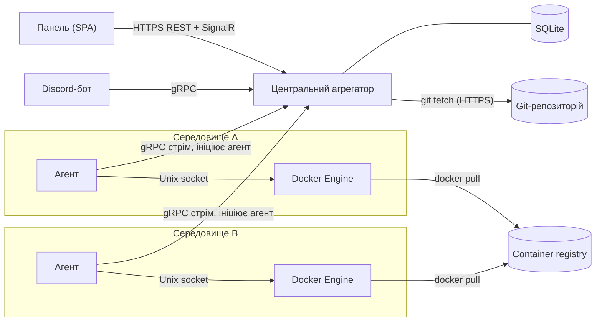

## Словник

- **Середовище (Environment)** — один хост з Docker і встановленим агентом.
- **Стек (Stack)** — набір сервісів, описаний одним `compose.yaml`; належить одному середовищу.
- **Агент (ЕА)** — сервіс на хості, який виконує команди ЦА через Docker. Сам нічого не вирішує.
- **Пакет (Bundle)** — усе, що ЦА надсилає агенту для деплою стеку: файли, розшифровані секрети, env, креди registry.
- **Деплой (Deployment)** — одне виконання пайплайну для конкретного стеку й коміту; має статус, лог і commit SHA.

## Архітектура



| Від → до | Протокол | Автентифікація |
|---|---|---|
| Панель → ЦА | HTTPS REST + SignalR (WebSocket) | cookie сесії користувача |
| Бот → ЦА | gRPC | сервісний токен бота + Discord ID користувача, від імені якого діє |
| Агент → ЦА | gRPC bidi-стрім, з'єднання відкриває агент | `agent_id` + секрет (опційно mTLS) |
| Агент → Docker | Unix socket | — (агент фактично має root на хості) |
| Docker → registry | HTTPS | тимчасовий `DOCKER_CONFIG` з кредами від ЦА |
| ЦА → Git | HTTPS | deploy-токен лише на читання (SSH не підтримується LibGit2Sharp) |

## Інваріанти безпеки

Це правила, які не можна порушувати в жодному PR:

1. Приватні age-ключі існують **лише на ЦА**. Агенти їх ніколи не отримують.
2. Агент **не відкриває вхідних портів**. Усі з'єднання ініціює агент.
3. `environmentId` агента визначається з його автентифікації, **ніколи з вмісту повідомлення**.
4. Права перевіряються **лише на ЦА**. Панель і бот тільки ховають недоступні кнопки.
5. Агент виконує лише **фіксований набір типізованих команд**. Жодного "виконай довільну shell-команду".
6. Розшифровані секрети **не логуються**. Логи й аудит маскують значення.
7. Команди до офлайн-агента **не ставляться в чергу**: вони одразу завершуються помилкою.
8. Облікові дані агентів і паролі користувачів зберігаються лише як хеші.

## Права доступу

| Роль | Бачить стеки й статус | Логи | start / stop / restart | exec / консоль | Редагування стеку, деплой |
|---|---|---|---|---|---|
| Viewer | ✓ | ✓ | – | – | – |
| Operator | ✓ | ✓ | ✓ | – | – |
| Editor | ✓ | ✓ | ✓ | ✓ | ✓ |
| Admin | усе в системі, включно з керуванням користувачами | | | | |

- Роль видається на середовище або на окремий стек. **Ефективна роль на стеку = максимум із ролі на середовищі та ролі на стеку.** Явних заборон немає, щоб модель лишалась простою.
- Приватне середовище бачать лише ті, хто має роль на ньому або на одному з його стеків (у другому випадку — лише ці стеки).
- ⚠️ **Editor на середовищі фактично має root на хості**: compose-файл може змонтувати `/` хоста або запустити `privileged`-контейнер. Видавайте цю роль свідомо.
- ⚠️ Логи контейнерів можуть містити секрети, які застосунки самі вивели в stdout. Viewer їх побачить.
- Вхід через OAuth2/OIDC **не створює користувача автоматично з правами**: зовнішній акаунт або прив'язується до існуючого користувача, або створює користувача без жодних ролей.

## Самокерування

Якщо ЦА працює на хості, який сам є середовищем системи:

- Стеки ЦА і агента позначаються як **системні**. `down` і `remove` для них заборонені.
- `restart` / `redeploy` системного стеку не можна виконувати напряму: агент, який робить `compose up` власного контейнера, зупиняє сам себе посеред команди. Оновлення виконується через одноразовий helper-контейнер, який агент запускає і який переживає перезапуск агента.
- Панель має очікувати, що після оновлення ЦА з'єднання обірветься, і показувати стан "перепідключення", а не помилку.

## Поведінка при збоях

- **Агент офлайн** → середовище позначається `Offline`, кнопки дій неактивні, команди одразу повертають помилку.
- **Перезавантаження хоста** → файлові секрети на tmpfs зникають. Агент після підключення повідомляє новий `boot_id`, ЦА повторно надсилає секрети (rehydrate), агент робить `up -d`.
- **Деплой впав** → попередні файли стеку зберігаються в `<stack>.prev`, доступний rollback.
- **ЦА недоступний** → контейнери на хостах продовжують працювати. Агент перепідключається з експоненційною затримкою.

## Не входить у скоуп

- Docker Swarm, Kubernetes.
- Збірка образів на хостах (`build:` у compose). Образи збирає CI і публікує в registry.
- Власний container registry.
- Встановлення й оновлення самого Docker Engine.

## Структура репозиторію (не вирішено, точно зміниться)

Назви проєктів умовні.

```
src/
  Project.Contracts/     .proto, спільні для ЦА, агента й бота
  Project.Core/          домен, команди, пайплайн, авторизація
  Project.Aggregator/    ASP.NET Core: REST, SignalR, gRPC
  Project.Agent/         .NET Worker Service
  Project.DiscordBot/
web/                     Vite + React + TS
tests/
deploy/                  compose-файли для ЦА і агента
docs/
  adr/                   записи архітектурних рішень
  retro/                 ретроспективи по бібліотеках (лаба 3)
  analogs.md             аналіз аналогів
```

## Локальний запуск

Потрібно: .NET 10 SDK, Node.js 22, Docker (на Windows — Docker Desktop).

1. `dotnet run --project src/Project.Aggregator` — ЦА на `http://localhost:5080`.
2. В UI створити середовище й скопіювати enrollment-токен.
3. `dotnet run --project src/Project.Agent` з `DOCKYARD_ENROLLMENT_TOKEN=<токен>` — агент підключиться до локального Docker.
4. `cd web && npm ci && npm run dev` — панель на `http://localhost:5173`; `/api` і `/hubs` проксюються на ЦА.

⚠️ Для розробки використовуйте локальний Docker або тестовий сервер, **не продакшн-інфраструктуру**.

## Правила роботи в команді

- Жодних прямих комітів у `main`. Лише PR з хоча б одним рев'ю від іншого учасника.
- Коміти за [Conventional Commits](https://www.conventionalcommits.org/): `feat(agent): ...`, `fix(web): ...`.
- **`CONTRIBUTIONS.md`** — кожен веде свій список класів, методів, ієрархій, екранів і обробників для лаб. Оновлюйте разом із PR, а не в кінці семестру.
- Нотатки для ретроспективи з лаби 3 пишіть у `docs/retro/<бібліотека>.md` одразу, поки пам'ятаєте проблеми.
- Архітектурні рішення, про які сперечались (наприклад, "git тягне ЦА, а не агент"), фіксуйте короткими ADR у `docs/adr/`.
