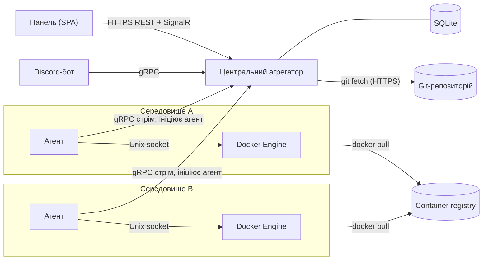

# container-forest

Керування Docker-контейнерами на кількох серверах через одну вебпанель і Discord-бот. Конфігурація застосунків живе в git, секрети в ньому зашифровані через SOPS і розшифровуються лише в центральному сервісі.

> **Статус:** альфа-версія в розробці. Центральний сервіс, агент і Discord-бот уже працюють разом: реєстрація агента, перегляд контейнерів і дії з ними, розгортання стеку з git, вхід за паролем. Від вебпанелі поки є каркас і екран входу. Це навчальний проєкт курсу ООП.

## Для кого

Для невеликої інфраструктури: від одного до кількох серверів зі звичайним Docker Compose, без Kubernetes і Swarm, і команда, де в людей різний рівень доступу. Типові задачі:

- бачити стан усіх серверів в одному місці, а не ходити на кожен по SSH;
- тримати конфігурацію разом із секретами в git, не зберігаючи паролі відкритим текстом;
- дати людині право перезапускати один сервіс на одному сервері, не видаючи їй повного доступу;
- перезапустити сервіс, що впав, з телефона командою в Discord.

## Можливості

**Альфа-версія:**

- агент на кожному сервері, реєстрація за одноразовим токеном, статус онлайн/офлайн;
- контейнери кожного сервера, їхній стан і логи; запуск, зупинка, перезапуск;
- вхід за логіном і паролем, доступ до окремих серверів;
- розгортання стеку з git-репозиторію.

**Остаточна версія:**

- секрети SOPS з окремим ключем для кожного сервера;
- окремі дії `restart`, `redeploy`, `redeploy with pull` і `down` замість однієї кнопки «оновити»;
- ролі Viewer / Operator / Editor / Admin на сервері або на окремому стеку, журнал аудиту;
- 2FA, вхід через OIDC і OAuth2;
- Discord-бот зі сповіщеннями й тими самими правами, що й у вебпанелі;
- історія деплоїв з прив'язкою до комітів і відкатом, графіки ресурсів.

## Чим відрізняється від аналогів

Порівняно з Portainer, Dockge і Komodo:

1. **Секрети лежать у git у зашифрованому вигляді**, і кожен сервер має власний ключ. В аналогах секрети зберігаються відкритим текстом або у власному сховищі інструмента.
2. **Discord — повноцінний інтерфейс керування**, а не лише канал сповіщень, з тією самою моделлю прав.
3. **Свідомо вужчий скоуп:** лише звичайний Docker і Compose, тож систему простіше встановити й зрозуміти.

Повний аналіз, у тому числі в чому ми поступаємося, — у [docs/project-overview.md](docs/project-overview.md#8-аналіз-аналогів).

## Як це влаштовано

- **Агент сам підключається до центрального сервісу.** На серверах немає відкритих вхідних портів, Docker API не виставляється в мережу, сервери можуть стояти за NAT.
- **Агент виконує лише фіксований набір типізованих команд**, описаних у Protocol Buffers. Команди «виконай довільну shell-команду» немає.
- **Секрети й права — лише в центральному сервісі.** Агенти отримують уже розшифровані значення безпосередньо перед розгортанням; вебпанель і бот лише ховають недоступні дії.

Технології: C# і .NET 10 (ASP.NET Core, gRPC, EF Core, SQLite), React і TypeScript (Vite, TanStack Router і Query), Discord.Net, SOPS і age.

## Документація

- [docs/architecture.md](docs/architecture.md) — компоненти, протоколи, інваріанти безпеки, модель прав, поведінка при збоях.
- [docs/project-overview.md](docs/project-overview.md) — мотивація, цільові користувачі, аналіз аналогів, зв'язок із лабораторними.
- [docs/adr/](docs/adr/README.md) — архітектурні рішення з обґрунтуванням.
- [CONTRIBUTING.md](CONTRIBUTING.md) — правила команди, структура репозиторію, локальний запуск.
- [CONTRIBUTIONS.md](CONTRIBUTIONS.md) — облік внеску учасників для лабораторних робіт.
- [docs/retro/](docs/retro/README.md) — ретроспективи використання зовнішніх бібліотек.
- [docs/ai-usage.md](docs/ai-usage.md) — як команда використовує генеративний ШІ.

## Навчальний проєкт

Курс «Об'єктно-орієнтоване програмування», 2026–2027. Тема — система керування Docker-контейнерами на кількох серверах (опис, команда й аналіз аналогів — у [docs/project-overview.md](docs/project-overview.md)).

| Вимога | Де в репозиторії |
|---|---|
| Лаби 1–3: класи, ієрархії, поліморфізм, екрани, бібліотеки | [CONTRIBUTIONS.md](CONTRIBUTIONS.md): окремо для кожного учасника, з переліком елементів |
| Ретроспективи бібліотек (лаба 3) | [docs/retro/](docs/retro/README.md) |
| Система контролю версій, робота в команді | гілки й PR із рев'ю, [CONTRIBUTING.md](CONTRIBUTING.md#правила-роботи-в-команді) |
| Unit-тести | `tests/` (xUnit v3), запускаються в [CI](.github/workflows/ci.yml) на кожен PR |
| Документація з коментарів у коді | [DocFX](https://dotnet.github.io/docfx/): сайт із документацією й довідником API збирає й публікує на GitHub Pages [workflow](.github/workflows/docs.yml) |
| Інтернаціоналізація | вебпанель українською й англійською (i18next), перемикач мови в інтерфейсі |
| Логування | `Microsoft.Extensions.Logging` у ЦА, агенті й боті; секрети не логуються ([інваріант 6](docs/architecture.md#інваріанти-безпеки)) |
| Стиль коду | C# — [конвенції .NET](https://learn.microsoft.com/dotnet/csharp/fundamentals/coding-style/coding-conventions), правила в [.editorconfig](.editorconfig); попередження компілятора й аналізаторів у CI — помилки |
| Використання LLM | [docs/ai-usage.md](docs/ai-usage.md) |

## Команда

[Петренко Богдан](https://github.com/lepterion), [Бояр Володимир](https://github.com/volodaboyar1-star), [Синенко Дмитро](https://github.com/Dmyt-S), [Денисенко Любов](https://github.com/denysenkoliubov) (ІПС-22). Ролі й розподіл відповідальності — у [docs/project-overview.md](docs/project-overview.md#команда).
