# container-forest

container-forest is GitOps for Docker Compose across several servers. Push to git and your stacks deploy. You can manage them from a web panel, a CLI or Discord. Secrets live in the same repository, encrypted with SOPS, and only the central service can decrypt them. No Kubernetes, Swarm or other orchestrator needed: just Docker on each server.

<picture>
  <source media="(prefers-color-scheme: dark)" srcset="docs/images/stacks-forest-dark.webp">
  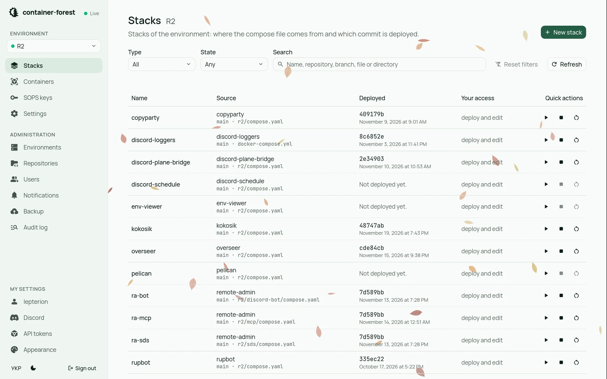
</picture>

> **Pre-1.0.** container-forest runs real production infrastructure successfully. Until 1.0, a minor release may include breaking changes; the [changelog](CHANGELOG.md) lists them.

## Who it is for

Small setups: one to a handful of servers with plain Docker Compose, no Kubernetes or Swarm, and a team where people need different levels of access. Typical needs:

- see every server's containers in one place instead of SSHing into each;
- keep configuration and secrets in git without storing passwords in plain text;
- let someone restart one service on one server without giving them the whole server;
- restart a crashed service from your phone with a Discord command.

## Features

- **Agents.** One per server, enrolled with a one-time token. Agents connect out to the central service, so servers need no open ports and can sit behind NAT.
- **Containers.** State and logs of every container; start, stop, restart.
- **Resource usage.** CPU, memory, network, disk and process graphs for containers, stacks and servers, alerts on high usage, and the same numbers in the CLI and the bot.
- **GitOps deployments.** Deploy a stack from a public or private git repository by hand, on push (webhook) or from CI (deploy hook). Every deployment records the commit it came from. Optionally require signed commits.
- **Secrets in git.** SOPS with a separate age key per server (or per stack). With the `forest` git filter you edit secrets in plain text in your clone and commit them encrypted.
- **Explicit operations.** `restart`, `redeploy`, `redeploy with pull` and `down` are separate actions, not one "update" button.
- **Image updates.** Per-stack image policies: the service notices new image versions and commits the new tag to the stack's repository.
- **Access control.** Viewer / Operator / Editor / Admin roles on a server or on a single stack, a compose policy per server (what stacks may mount and run), and an audit log.
- **Sign-in.** Password, passkeys or Discord.
- **Discord bot.** Commands, menus and notifications (deployments, crashed containers, agents going offline) with the same permissions as the panel.
- **CLI `forest`.** Browser sign-in, scoped personal API tokens (read-only, selected servers, expiry), everything the panel can do.
- **Panel.** English and Ukrainian, live updates, works on a phone, installable as a PWA.
- **Backups** of the central service to S3-compatible storage, encrypted to an offline key.

Not there yet: 2FA and OIDC sign-in, rolling back a deployment from the panel, live log streaming, a container shell.

## Screenshots

A stack: where it comes from, what you can do with it, its containers.

<picture>
  <source media="(prefers-color-scheme: dark)" srcset="docs/images/stack-forest-dark.webp">
  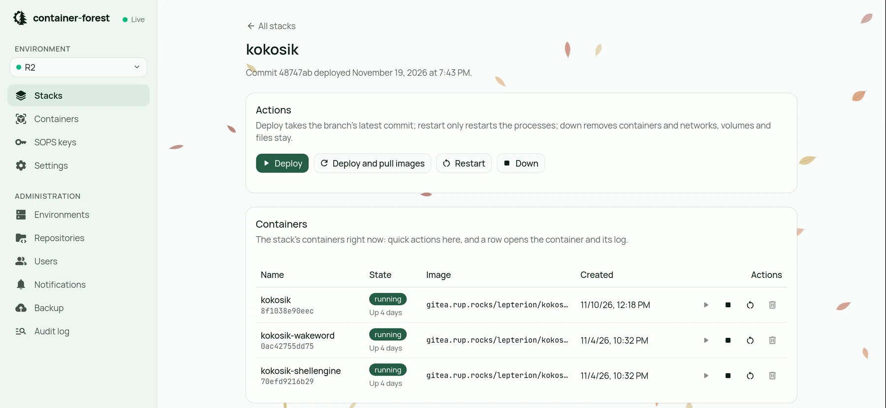
</picture>

A deployment started by a git push, with its commit and log.

<picture>
  <source media="(prefers-color-scheme: dark)" srcset="docs/images/deployment-forest-dark.webp">
  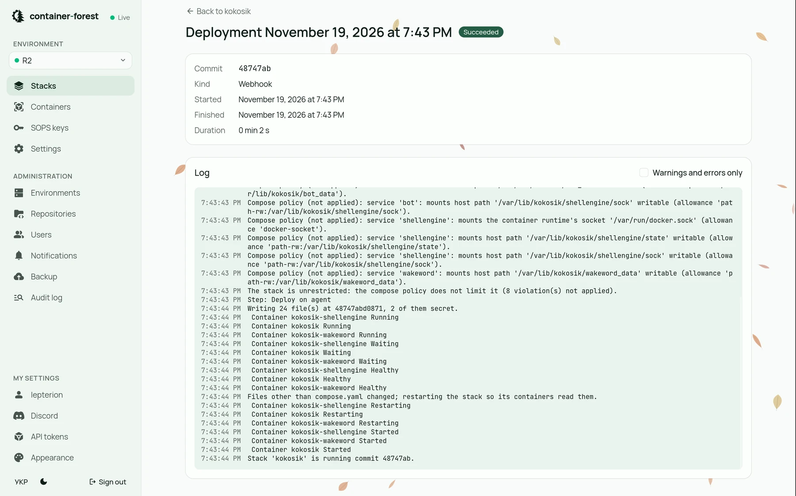
</picture>

A container's resource usage over a week; triangles mark deployments.

<picture>
  <source media="(prefers-color-scheme: dark)" srcset="docs/images/metrics-forest-dark.webp">
  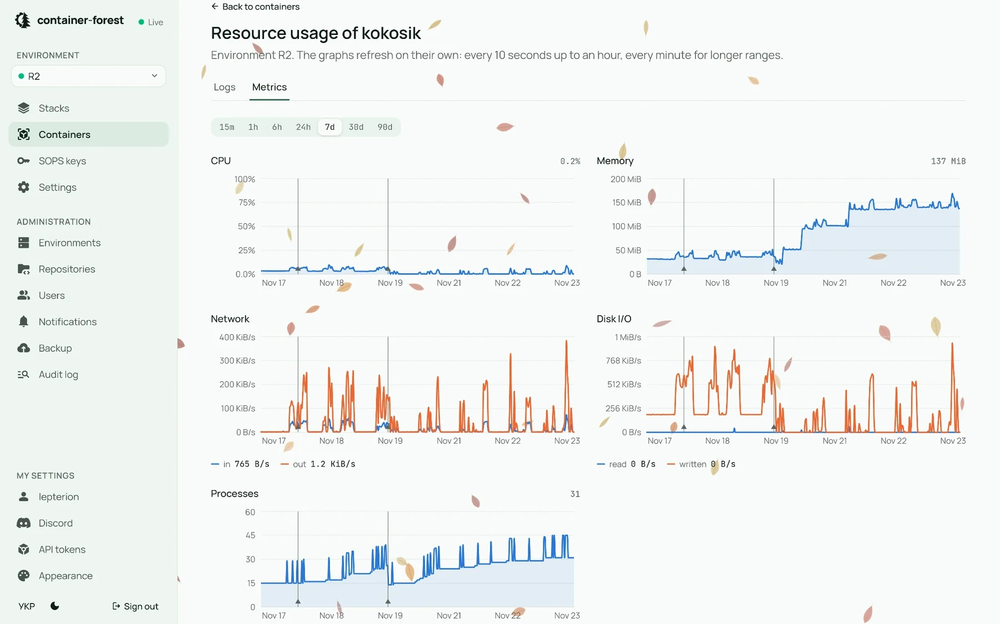
</picture>

Roles on a whole server or on a single stack.

<picture>
  <source media="(prefers-color-scheme: dark)" srcset="docs/images/user-forest-dark.webp">
  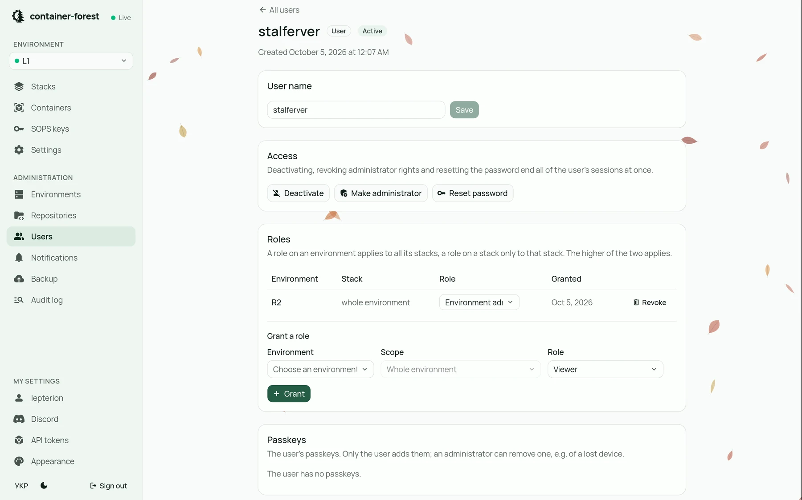
</picture>

The same pages and actions on a phone.

<picture>
  <source media="(prefers-color-scheme: dark)" srcset="docs/images/mobile-forest-dark.webp">
  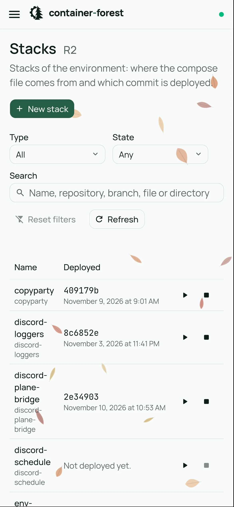
</picture>

Five colour themes, each light and dark; the screenshots above use the default, *forest*. The falling leaves are the seasonal backdrop: young leaves in spring, butterflies and poplar fluff in summer, falling leaves in autumn, snow in winter, or rain all year if you choose it. It can be turned off.

<table>
<tr>
<td align="center"><picture><source media="(prefers-color-scheme: dark)" srcset="docs/images/theme-forest-dark.webp">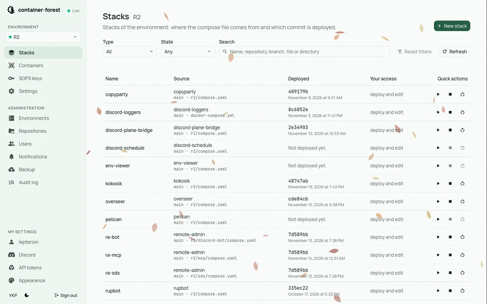</picture><br><em>forest</em></td>
<td align="center"><picture><source media="(prefers-color-scheme: dark)" srcset="docs/images/theme-meadow-dark.webp">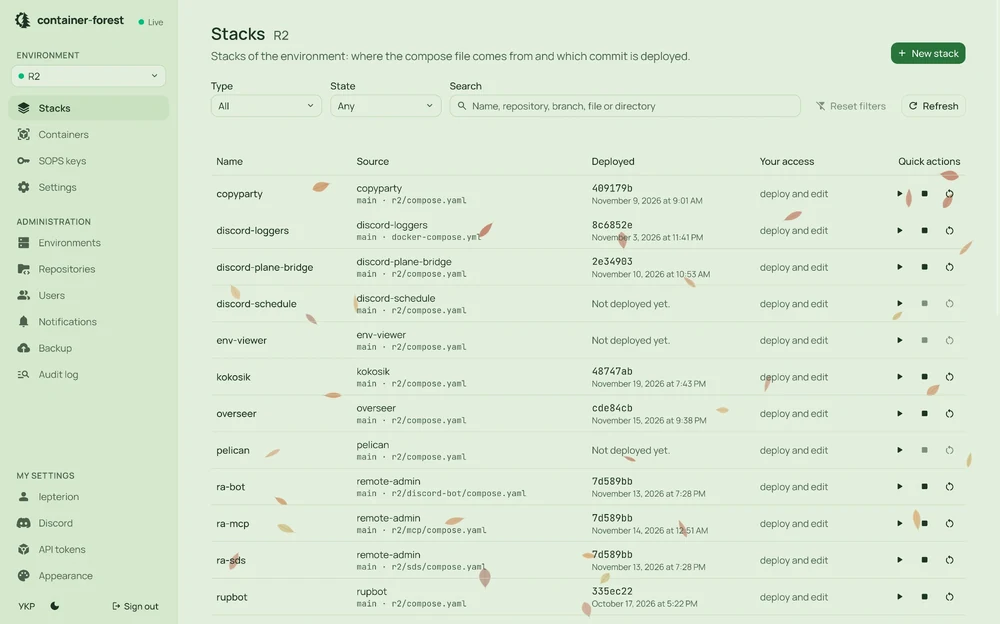</picture><br><em>meadow</em></td>
<td align="center"><picture><source media="(prefers-color-scheme: dark)" srcset="docs/images/theme-lilac-dark.webp">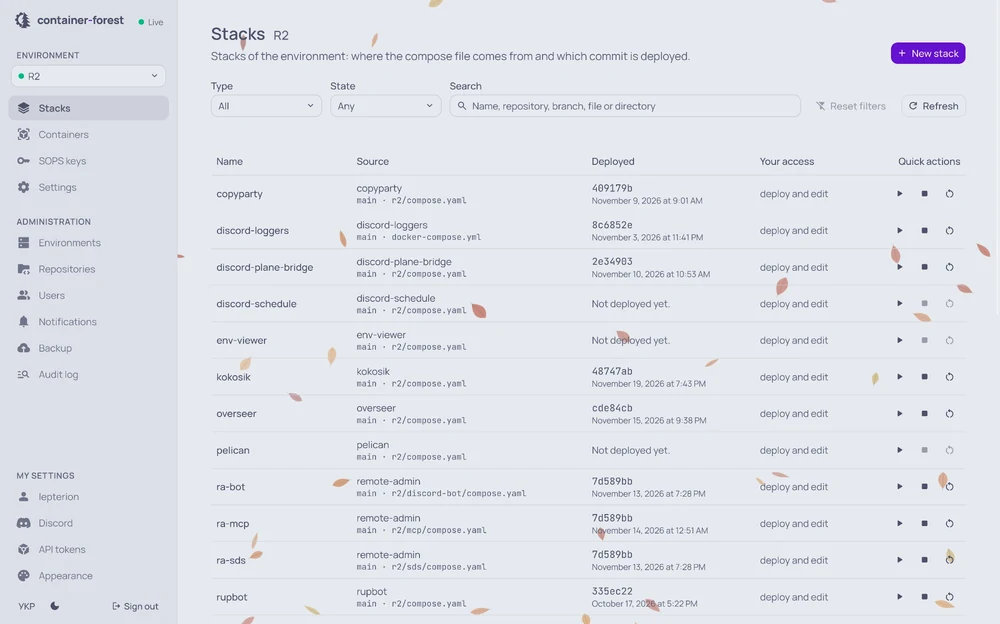</picture><br><em>lilac</em></td>
</tr>
<tr>
<td align="center"><picture><source media="(prefers-color-scheme: dark)" srcset="docs/images/theme-lake-dark.webp">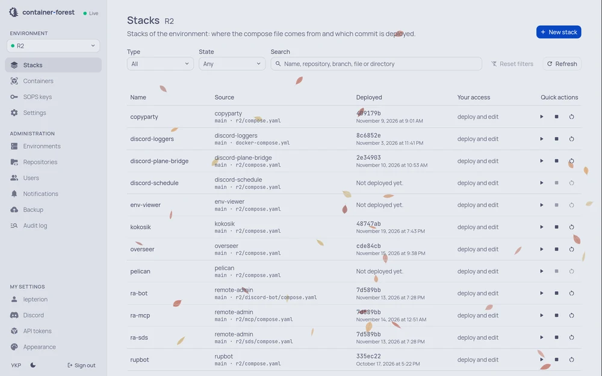</picture><br><em>lake</em></td>
<td align="center"><picture><source media="(prefers-color-scheme: dark)" srcset="docs/images/theme-sunset-dark.webp">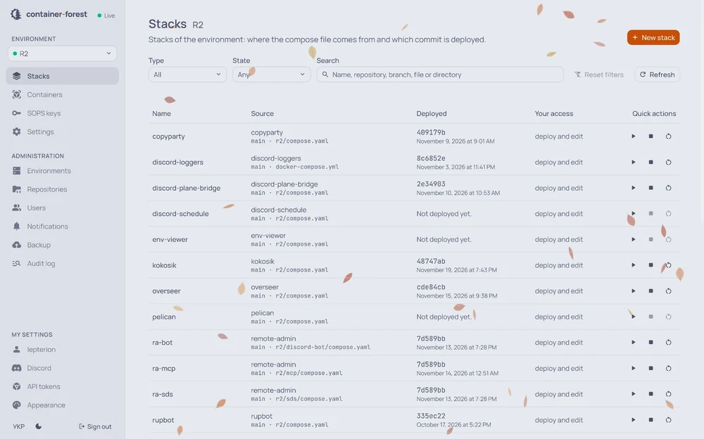</picture><br><em>sunset</em></td>
<td align="center"><picture><source media="(prefers-color-scheme: dark)" srcset="docs/images/theme-picker-dark.webp">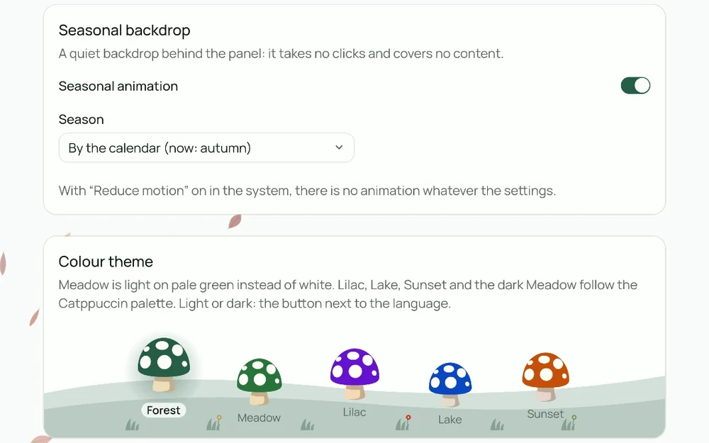</picture><br><em>Appearance</em></td>
</tr>
</table>

## How it compares

Next to Portainer, Dockge and Komodo, container-forest:

1. **keeps secrets in git, encrypted**, with a key per server. The others store secrets in plain text or in their own database.
2. **treats Discord as a full interface**, not only a notification channel, with the same permission model.
3. **does less on purpose:** only Docker and Compose, so it is easier to install and to reason about.

Where it falls short of them, and a longer comparison: [docs/comparison.md](docs/comparison.md).

## How it works

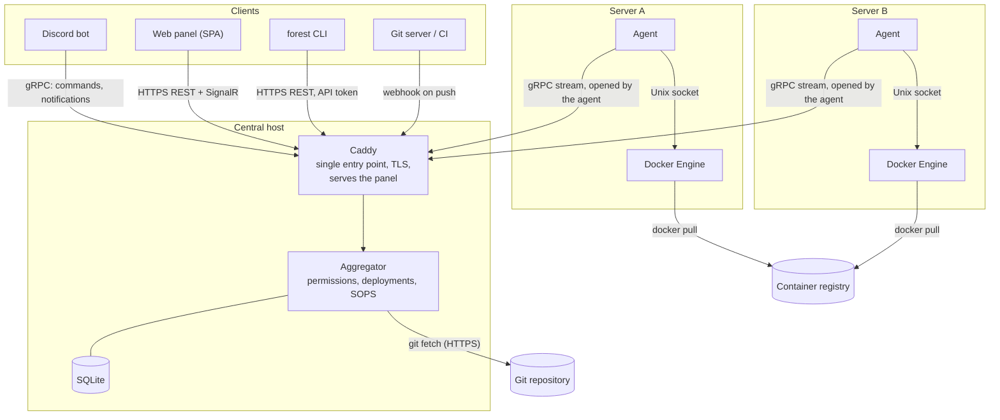

- **Agents dial in.** The Docker API is never exposed to the network.
- **Agents run a fixed set of typed commands** defined in Protocol Buffers. The agent never executes arbitrary shell commands on the host.
- **Secrets, policies and permissions are stored and enforced in the aggregator.** Agents receive decrypted values just before a deployment; the panel, the bot and the CLI only hide actions you cannot perform.

Built with C# and .NET 10 (ASP.NET Core, gRPC, EF Core, SQLite), React and TypeScript (Vite, TanStack Router and Query), Discord.Net, SOPS and age.

## Quick start

You need a host with Docker and a DNS name pointing to it (ports 80 and 443 reachable) for the aggregator, and Docker on every server you want to manage.

1. **Run the aggregator and the panel** on the central host:

   ```sh
   mkdir -p /srv/container-forest && cd /srv/container-forest
   curl -fsSLO https://raw.githubusercontent.com/lepterion/container-forest/main/deploy/aggregator/compose.yaml
   cat > .env <<'EOF'
   CF_DOMAIN=forest.example.com
   CF_BOOTSTRAP__ADMINUSERNAME=admin
   CF_BOOTSTRAP__ADMINPASSWORD=change-me-to-12+-chars
   EOF
   chmod 600 .env
   docker compose up -d
   ```

   Caddy gets a Let's Encrypt certificate for `CF_DOMAIN`. Sign in at `https://forest.example.com`, then remove the two `CF_BOOTSTRAP__*` lines.

2. **Add a server.** In the panel, open *Environments → New environment*. It shows a one-time enrollment token and a ready `compose.yaml` for the agent. Run it on that server with `docker compose up -d`; the server goes online in the panel.

3. **Deploy a stack.** Add a git repository (for a private one, first add a git connection with a read-only token), then create a stack on the environment: repository, branch and path to `compose.yaml`. Press *Deploy*, or turn on deploy on push.

4. **Optional:** install the CLI from the [latest release](https://github.com/lepterion/container-forest/releases/latest) (`forest-linux-x64`, `forest-linux-arm64`, `forest-osx-arm64`, `forest-win-x64.exe`) and run `forest login https://forest.example.com`. To use the Discord bot, see [deploy/discord-bot/compose.yaml](deploy/discord-bot/compose.yaml).

The full guide, including SOPS secrets, backups and upgrades: [docs/installation.md](docs/installation.md).

## Documentation

- [Installation](docs/installation.md): deployment, configuration, upgrades and backups.
- [Architecture](docs/architecture.md): components, protocols, the permission model, failure behaviour.
- [Security invariants](docs/security-invariants.md): the rules every change must keep.
- [Design notes](docs/design/README.md) and [ADRs](docs/adr/README.md): how each subsystem works and why.
- [API reference](https://lepterion.github.io/container-forest/): generated from the code comments.

## Development process

Most of the code is written with AI coding agents (Claude Code), with people designing the system, deciding what goes in and reviewing every change. Agent-written code goes through the same review, CI, tests and [security invariants](docs/security-invariants.md) as any other; the `CLAUDE.md` files hold the rules the agents follow.

## Contributing

Bug reports, ideas and pull requests are welcome. Start with [CONTRIBUTING.md](CONTRIBUTING.md) and the [Code of Conduct](CODE_OF_CONDUCT.md). To report a vulnerability, see [SECURITY.md](SECURITY.md); please don't open a public issue for it.

## License

[Apache License 2.0](LICENSE). Third-party components shipped in the images and CLI binaries are listed in [NOTICE](NOTICE).

container-forest was started in 2026 by [Bohdan Petrenko](https://github.com/lepterion), [Volodymyr Boiar](https://github.com/volodaboyar1-star), [Dmytro Synenko](https://github.com/Dmyt-S) and [Liubov Denysenko](https://github.com/denysenkoliubov).
