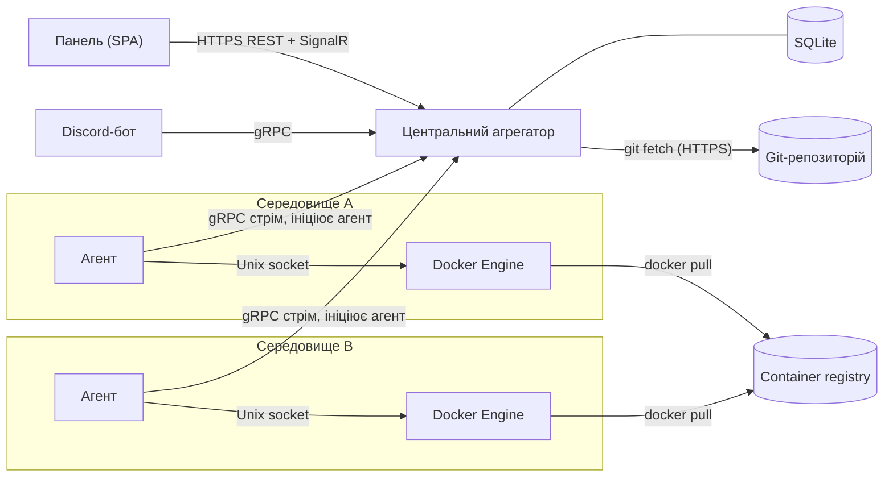

# Архітектура container-forest

Технічний опис системи: компоненти, протоколи, модель безпеки й прав. Для чого проєкт і чим він відрізняється від аналогів — у [README](../README.md) і [project-overview.md](project-overview.md). Архітектурні рішення з обґрунтуванням — в [adr/](adr/README.md).

## Компоненти системи

1. **Центральний агрегатор (ЦА)** — програма на ASP.NET, HTTP-сервер, gRPC-сервер; контролює все.
2. **Енвайронмент агент (ЕА)** — програма на .NET, встановлюється на кожне середовище, під'єднується як gRPC-клієнт до ЦА, спілкується з двигуном Docker через Unix socket, медіатор між ЦА і Docker.
3. **Панель** — SPA на React, веб-застосунок для ручного керування системою; браузер спілкується з ЦА через HTTP(S).
4. **Discord-бот** (не критично) — застосунок на .NET (фреймворк Discord.Net) для легковісного інтерфейсу керування в Discord; спілкується з ЦА через gRPC. Автентифікується власним сервісним токеном і передає Discord ID користувача, від імені якого діє; ЦА перевіряє права саме цього користувача.
5. **База даних** — SQLite (PostgreSQL можливо в майбутньому; підтримка обох одразу означає два набори міграцій).

## Мови і фреймворки

1. Backend і все, не пов'язане з інтерфейсом — C#, .NET 10 (перейдемо на 11 після його релізу в листопаді, якщо залежності дозволять), агрегатор на ASP.NET Core (+ ASP.NET Core gRPC Service). ЦА має працювати у двох режимах: за reverse proxy, який термінує TLS (тоді `UseForwardedHeaders`), і без проксі, коли Kestrel сам обслуговує HTTPS із сертифікатом, заданим конфігурацією (файл сертифіката; випуск і поновлення — поза ЦА). Другий режим — не на часі.
2. Frontend: сайт окремою програмою на рівні з агентами, SPA, React, TS, TanStack Router, TanStack Query, React Context.

## Особливості модулів і системи

1. Опціонально можна реалізувати mTLS, щоб ускладнити неавторизоване підключення.
2. Аутентифікація за логіном і паролем за замовчуванням, 2FA, а також можливість налаштувати зовнішній вхід: OIDC (наприклад, Google) і OAuth2 (наприклад, Discord — він не підтримує OIDC).
3. ЦА розпоряджається приватними й публічними ключами для SOPS.
4. Система пайплайну деплою (абстрактна). Наприклад: ЦА: git fetch → sops decrypt → verify images → resolve target environments → resolve registry auth → build bundle → send to agent; ЕА: update stacks & secrets → docker pull → docker compose up; ЦА: пост-деплой хуки, логування тощо.
5. Керування стеками у веб-застосунку: up / down / restart / redeploy / redeploy with pull, логи контейнерів (приблизно як у Portainer), статус контейнерів, керування кожним контейнером окремо (start / stop / restart / remove?), exec?, attach console?, графіки використання ресурсів.
   - `restart` — `docker compose restart`, перезапуск процесів у наявних контейнерах;
   - `redeploy` — `docker compose up -d --pull missing`;
   - `redeploy with pull` — `docker compose up -d --pull always`;
   - `down` — окрема дія: видаляє контейнери й мережі стеку.
6. ЦА, якщо запущений на сервері, який має бути в системі, має мати агента для самого себе (див. «Самокерування»).
7. Керування доступом і користувачами: можна робити середовища приватними, видавати доступ окремим користувачам; можна видавати доступ і до окремих стеків (права наслідуються). Користувачам можна давати доступ лише до кнопок start / restart / stop або повний. Є користувачі-адміністратори, які мають доступ до всього і можуть керувати користувачами (див. «Права доступу»).

## Словник

- **Середовище (Environment)** — один хост з Docker і встановленим агентом.
- **Стек (Stack)** — набір сервісів, описаний одним `compose.yaml`; належить одному середовищу.
- **Агент (ЕА)** — сервіс на хості, який виконує команди ЦА через Docker. Сам нічого не вирішує.
- **Пакет (Bundle)** — усе, що ЦА надсилає агенту для деплою стеку: файли, розшифровані секрети, env, креди registry.
- **Деплой (Deployment)** — одне виконання пайплайну для конкретного стеку й коміту; має статус, лог і commit SHA.

## Схема і протоколи



| Від → до | Протокол | Автентифікація |
|---|---|---|
| Панель → ЦА | HTTPS REST + SignalR (WebSocket) | cookie сесії користувача (`cf_session`) |
| Бот → ЦА | gRPC | сервісний токен бота + Discord ID користувача, від імені якого діє |
| Агент → ЦА | gRPC bidi-стрім (пакет `agent`), з'єднання відкриває агент | `agent_id` + секрет у metadata `x-agent-id` / `x-agent-secret` (опційно mTLS) |
| Агент → Docker | Unix socket | — (агент фактично має root на хості) |
| Docker → registry | HTTPS | тимчасовий `DOCKER_CONFIG` з кредами від ЦА |
| ЦА → Git | HTTPS | токен підключення лише на читання, лише під його префіксом (SSH не підтримується LibGit2Sharp) |

## Інваріанти безпеки

Це правила, які не можна порушувати в жодному PR:

1. Приватні age-ключі існують **лише на ЦА**. Агенти їх ніколи не отримують.
2. Агент **не відкриває вхідних портів**. Усі з'єднання ініціює агент.
3. `environmentId` агента визначається з його автентифікації, **ніколи з вмісту повідомлення**.
4. Права перевіряються **лише на ЦА**. Панель і бот тільки ховають недоступні кнопки.
5. Агент виконує лише **фіксований набір типізованих команд**. Жодного «виконай довільну shell-команду».
6. Розшифровані секрети **не логуються**. Логи й аудит маскують значення.
7. Команди до офлайн-агента **не ставляться в чергу**: вони одразу завершуються помилкою.
8. Облікові дані агентів і паролі користувачів зберігаються лише як хеші.
9. Токен Discord-бота захищається як адмінський: злам бота дозволяє діяти від імені будь-якого прив'язаного користувача.

## Права доступу

| Роль | Бачить стеки й статус | Логи | start / stop / restart | exec / консоль | Редагування стеку, деплой |
|---|---|---|---|---|---|
| Viewer | ✓ | ✓ | – | – | – |
| Operator | ✓ | ✓ | ✓ | – | – |
| Editor | ✓ | ✓ | ✓ | ✓ | ✓ |
| Admin | усе в системі, включно з керуванням користувачами | | | | |

- Роль видається на середовище або на окремий стек. **Ефективна роль на стеку = максимум із ролі на середовищі та ролі на стеку.** Явних заборон немає, щоб модель лишалась простою.
- Приватне середовище бачать лише ті, хто має роль на ньому або на одному з його стеків (у другому випадку — лише ці стеки).
- Стеки додає й видаляє Editor середовища (Editor окремого стеку — ні). Видалити можна лише стек без контейнерів: ніколи не розгорнутий або зупинений через down; разом із ним зникають історія деплоїв, ролі на ньому й правила сповіщень про нього, а файли на хості лишаються.
- ⚠️ **Editor на середовищі фактично має root на хості**: compose-файл може змонтувати `/` хоста або запустити `privileged`-контейнер. Видавайте цю роль свідомо.
- ⚠️ Логи контейнерів можуть містити секрети, які застосунки самі вивели в stdout. Viewer їх побачить.
- Репозиторії й підключення до git-серверів (ADR-0006): підключення (префікс адреси, токен, дозволені середовища) створює лише адміністратор. Editor середовища або стеку додає публічні репозиторії й репозиторії під підключеннями, дозволеними в його середовищах; змінює репозиторій той, хто може деплоїти кожен його стек. Стек може брати лише репозиторій, дозволений у своєму середовищі, тож приватний репозиторій одного середовища не потрапить на хост іншого.
- Вхід через OAuth2/OIDC **не створює користувача автоматично з правами**: зовнішній акаунт або прив'язується до існуючого користувача, або створює користувача без жодних ролей.

## Самокерування

Якщо ЦА працює на хості, який сам є середовищем системи:

- Стеки ЦА і агента позначаються як **системні**. `down` і `remove` для них заборонені.
- ЦА, панель і агентів розгортають вручну за `deploy/*.yaml`, а не пайплайном, тож керованими стеками вони не є. Тому їхні compose-файли ставлять контейнерам мітку `com.container-forest.system: "true"`; агент передає її ЦА (`ContainerInfo.system`), і такі контейнери, як і контейнери системних стеків, можна лише запускати: stop і restart обірвали б з'єднання, яким ідуть команди (зупинений агент або Caddy відрізав би хост від ЦА). Ставлячи ці сервіси інакше, мітку треба додати самостійно.
- `restart` / `redeploy` системного стеку не можна виконувати напряму: агент, який робить `compose up` власного контейнера, зупиняє сам себе посеред команди. Оновлення виконується через одноразовий helper-контейнер, який агент запускає і який переживає перезапуск агента.
- Панель має очікувати, що після оновлення ЦА з'єднання обірветься, і показувати стан «перепідключення», а не помилку.

## Підключення до git-серверів

Приватні репозиторії ЦА тягне через **підключення** (ADR-0006): префікс адреси (`https://gitea.example.com/team/` — організація, весь сервер або один репозиторій), токен лише на читання й середовища, які можуть з них деплоїти. Токен надсилається лише на адреси під префіксом. Для Gitea, де токен не обмежується одним репозиторієм, підключенню дають токен службового користувача, доданого в команди з доступом на читання: що він бачить, вирішує Gitea, а підключення — яким середовищам це дозволено. Репозиторії під підключенням додають редактори без токенів. Репозиторій без підключення публічний; ЦА не тягне його з приватних адрес мережі (захист від SSRF), хіба що задано `Git:AllowPrivateHosts`.

## Деплой після push (webhook)

1. Хтось, хто може змінювати репозиторій, створює його секрет webhook у панелі («Репозиторії» → «Змінити» → «Webhook»). Секрет і адресу `https://<домен>/api/webhooks/<id репозиторію>` панель показує один раз; їх вставляють у налаштування webhook на GitHub (content type `application/json`, подія push), Gitea/Forgejo або GitLab (Secret token). Замість webhook на кожен репозиторій адміністратор може створити один webhook організації на підключенні (`https://<домен>/api/webhooks/connections/<id підключення>`): ЦА знайде репозиторій за адресою з тіла запиту.
2. Editor стеку вмикає «Деплой після push» на екрані стеку. Без цього push стек не чіпає.
3. Push у гілку стеку ставить у чергу звичайний деплой із тригером «Webhook»: ЦА перевіряє підпис секретом репозиторію й тягне голову гілки сам, тіло запиту лише каже, що вона змінилася. Push під час деплою стеку розгортається одразу після нього.

ЦА відповідає 401 однаково на неправильний підпис і на невідомий репозиторій чи підключення. Тіло й підпис не логуються. До офлайн-агента деплой не ставиться (інваріант 7).

## Хук деплою для CI

Деплой після push бере лише відсутні образи, тож новий образ під тим самим тегом (`latest`, `main`) він не підтягне. Для таких образів у стеку є хук деплою: Editor стеку створює його на екрані стеку («Хук деплою для CI»), панель один раз показує адресу `https://<домен>/api/deploy-hooks/<id стеку>` і токен, а CI після push образу викликає:

```sh
curl -fsS -X POST -H "Authorization: Bearer $FOREST_DEPLOY_HOOK" https://<домен>/api/deploy-hooks/<id стеку>
```

ЦА деплоїть голову гілки стеку з оновленням усіх образів (redeploy with pull), тригер в історії — «Хук деплою». Виклик під час деплою стеку розгортається одразу після нього. ЦА зберігає лише хеш токена; токен передається в заголовку, а не в адресі, бо адреси зберігають логи проксі й CI. На неправильний токен і невідомий стек — однаковий 401, до офлайн-агента — 503 (інваріант 7).

Відтворюваніший шлях — образи з незмінним тегом (`:<sha коміту>`), який CI комітить у репозиторій стеку: тоді вистачає деплою після push, а відкат — це `git revert`.

## Секрети в git (SOPS)

Секрети стеку лежать у репозиторії поруч із compose-файлом, зашифровані [SOPS](https://github.com/getsops/sops) для age-ключа середовища:

1. Адміністратор створює ключ середовища в панелі («Ключі»). Приватна частина генерується й лишається в ЦА (зашифрована Data Protection, ADR-0003); публічну (`age1…`) бачить кожен, хто бачить середовище.
2. У `.sops.yaml` репозиторію додається правило з публічним ключем середовища й власним ключем того, хто редагує секрети (інакше файл зможе розшифрувати лише ЦА). Файл шифрується `sops encrypt --in-place` і комітиться.
3. Під час деплою ЦА розшифровує файли з метаданими sops ключами **лише цільового середовища** й передає агенту як секретні: агент пише їх у tmpfs (`/run/container-forest`), а в каталог стеку кладе символьні посилання, тож compose-файл посилається на них звичайними відносними шляхами (`env_file: .env`, `secrets: … file: ./secrets/db_password`). На диск хоста й у логи відкритий текст не потрапляє.
4. Ротація: новий ключ → `sops updatekeys` для файлів → видалити старий. Доки старий ключ є, обидва розшифровують.

⚠️ Env-секрети (`env_file`, `environment`) Docker однаково зберігає в конфігурації контейнера на диску (`docker inspect`). Справді не торкаються диска лише файлові секрети.

## Поведінка при збоях

- **Агент офлайн** → середовище позначається `Offline`, кнопки дій неактивні, команди одразу повертають помилку.
- **Перезавантаження хоста** → файлові секрети в `/run/container-forest` (tmpfs) зникають. Агент після підключення повідомляє новий `boot_id`, ЦА повторно деплоїть той самий коміт кожного стеку, розгорнутого із секретами (rehydrate, тригер «Відновлення секретів» в історії деплоїв): секрети знову з'являються в tmpfs, а `compose up -d` запускає контейнери, що не стартували без них. Гілка при цьому не підтягується: деплоїться те, що вже працювало.
- **Змінився конфіг, а не образ** → `compose up` не перестворює контейнер, якщо не змінилося його визначення в compose-файлі, а застосунки читають змонтовані файли лише на старті. Для таких стеків на екрані стеку вмикається «Перезапускати після зміни файлів»: тоді агент після деплою, що змінив будь-який файл стеку, крім `compose.yaml`, перезапускає стек.
- **Деплой впав** → попередні файли стеку зберігаються в `/opt/container-forest/stacks/<stack>.prev`, доступний rollback. Каталог стеку при цьому не замінюється: оновлюються лише файли пакета, дані контейнерів у ньому лишаються (ADR-0004).
- **ЦА недоступний** → контейнери на хостах продовжують працювати. Агент перепідключається з експоненційною затримкою.

## Не входить у скоуп

- Docker Swarm, Kubernetes.
- Збірка образів на хостах (`build:` у compose). Образи збирає CI і публікує в registry.
- Власний container registry.
- Встановлення й оновлення самого Docker Engine.

## Розгортання ЦА

ЦА і панель працюють на одному хості: [`deploy/aggregator/compose.yaml`](../deploy/aggregator/compose.yaml). Єдиний вхід — Caddy в образі панелі (ADR-0005): він віддає SPA, проксює `/api`, `/hubs` і gRPC агентів і бота на ЦА й сам отримує сертифікат Let's Encrypt для домену. ЦА портів назовні не публікує.

```
Інтернет :443 → container-forest-web (Caddy)
                  ├─ /             → файли панелі
                  ├─ /api, /hubs   → aggregator:5080
                  └─ gRPC          → aggregator:5081 (h2c) ← агенти й бот
```

- Налаштування — у `.env` поруч із compose-файлом (не комітиться, доступний лише root): `CF_DOMAIN` (DNS-запис має вказувати на хост, порти 80 і 443 відкриті), перший адміністратор `CF_BOOTSTRAP__*`, за потреби хеш токена бота.
- Дані ЦА — том `aggregator-data` (`/data`: база, key ring Data Protection, git-клони). Бекапити цілком: без key ring не розшифруються ні збережені креди й токени, ні приватні age-ключі середовищ, а без них — і секрети в репозиторіях, зашифровані лише для цих ключів.
- Образ ЦА містить `sops` і `age-keygen` (версії й контрольні суми — у `scripts/install-sops.sh`).
- Сертифікати Caddy — том `caddy-data`.
- Агенти й бот підключаються до `https://<CF_DOMAIN>`.
- Образи — `ghcr.io/lepterion/container-forest-*` (workflow `Images` публікує їх з `main`). Поки репозиторій приватний, приватні й образи: на хості потрібен `docker login ghcr.io` з токеном GitHub із правом `read:packages`.

## Розгортання агента

Приклад — [`deploy/agent/compose.yaml`](../deploy/agent/compose.yaml). Каталоги монтуються за **однаковим шляхом** на хості й у контейнері: `docker compose` усередині агента працює через socket хоста, і шляхи bind-mount'ів резолвить daemon на хості.

```yaml
services:
  container-forest-agent:
    image: ghcr.io/lepterion/container-forest-agent:latest
    restart: unless-stopped
    hostname: <назва хоста>   # агент передає її ЦА при реєстрації; без неї в панелі буде id контейнера
    environment:
      CF_AGENT__CONTROLLERURL: https://forest.example.com
      CF_AGENT__ENROLLMENTTOKEN: ${ENROLLMENT_TOKEN}   # потрібен лише для першого запуску
    volumes:
      - /var/run/docker.sock:/var/run/docker.sock
      - /opt/container-forest:/opt/container-forest
      - /run/container-forest:/run/container-forest
```

## Розгортання Discord-бота

Бот — окремий контейнер без стану: лише вихідні з'єднання з Discord і з gRPC-портом ЦА, без томів і вхідних портів. Приклад — [`deploy/discord-bot/compose.yaml`](../deploy/discord-bot/compose.yaml): образ `container-forest-discord-bot` працює від непривілейованого користувача, з файловою системою лише для читання, без capabilities.

- `CF_BOT__CONTROLLERURL` — gRPC-адреса ЦА (та сама, що для агентів).
- `CF_BOT__SERVICETOKEN` — сервісний токен бота; ЦА зберігає лише його SHA-256 у `CF_BOTGATEWAY__TOKENHASHES__0`.
- `CF_DISCORD__TOKEN` — токен бота Discord. Невірний токен зупиняє контейнер з кодом 1 і підказкою в лозі.

⚠️ Обидва токени рівносильні адмінському доступу (інваріант 9). У прикладі вони приходять із `.env` поруч із compose-файлом, який не комітиться і доступний лише root.
