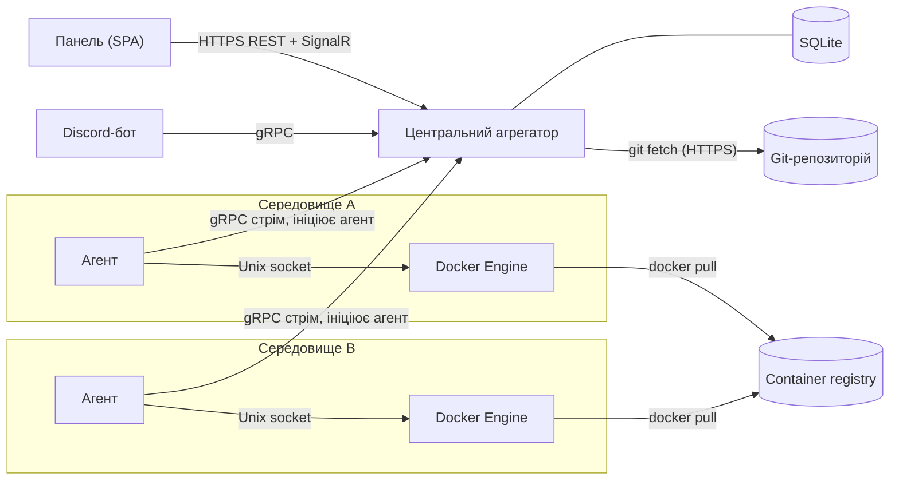

# Архітектура container-forest

Технічний опис системи: компоненти, протоколи, модель безпеки й прав. Для чого проєкт і чим він відрізняється від аналогів — у [README](../README.md) і [project-overview.md](project-overview.md). Архітектурні рішення з обґрунтуванням — в [adr/](adr/README.md).

## Компоненти системи

1. **Центральний агрегатор (ЦА)** — програма на ASP.NET, HTTP-сервер, gRPC-сервер; контролює все.
2. **Енвайронмент агент (ЕА)** — програма на .NET, встановлюється на кожне середовище, під'єднується як gRPC-клієнт до ЦА, спілкується з двигуном Docker через Unix socket, медіатор між ЦА і Docker.
3. **Панель** — SPA на React, веб-застосунок для ручного керування системою; браузер спілкується з ЦА через HTTP(S).
4. **Discord-бот** (не критично) — застосунок на .NET (фреймворк Discord.Net) для легковісного інтерфейсу керування в Discord; спілкується з ЦА через gRPC. Автентифікується власним сервісним токеном і передає Discord ID користувача, від імені якого діє; ЦА перевіряє права саме цього користувача.
5. **База даних** — SQLite (PostgreSQL можливо в майбутньому; підтримка обох одразу означає два набори міграцій).

## Мови і фреймворки

1. Backend і все, не пов'язане з інтерфейсом — C#, .NET 10 (перейдемо на 11 після його релізу в листопаді, якщо залежності дозволять), агрегатор на ASP.NET Core (+ ASP.NET Core gRPC Service). ЦА має працювати у двох режимах: за reverse proxy, який термінує TLS (тоді `UseForwardedHeaders`), і без проксі, коли Kestrel сам обслуговує HTTPS із сертифікатом, заданим конфігурацією (файл сертифіката; випуск і поновлення — поза ЦА). Другий режим — не на часі.
2. Frontend: сайт окремою програмою на рівні з агентами, SPA, React, TS, TanStack Router, TanStack Query, React Context.

## Особливості модулів і системи

1. Опціонально можна реалізувати mTLS, щоб ускладнити неавторизоване підключення.
2. Аутентифікація за логіном і паролем за замовчуванням, 2FA, а також можливість налаштувати зовнішній вхід: OIDC (наприклад, Google) і OAuth2 (наприклад, Discord — він не підтримує OIDC).
3. ЦА розпоряджається приватними й публічними ключами для SOPS.
4. Система пайплайну деплою (абстрактна). Наприклад: ЦА: git fetch → sops decrypt → verify images → resolve target environments → resolve registry auth → build bundle → send to agent; ЕА: update stacks & secrets → docker pull → docker compose up; ЦА: пост-деплой хуки, логування тощо.
5. Керування стеками у веб-застосунку: up / down / restart / redeploy / redeploy with pull, логи контейнерів (приблизно як у Portainer), статус контейнерів, керування кожним контейнером окремо (start / stop / restart / remove?), exec?, attach console?, графіки використання ресурсів.
   - `restart` — `docker compose restart`, перезапуск процесів у наявних контейнерах;
   - `redeploy` — `docker compose up -d --pull missing`;
   - `redeploy with pull` — `docker compose up -d --pull always`;
   - `down` — окрема дія: видаляє контейнери й мережі стеку.
6. ЦА, якщо запущений на сервері, який має бути в системі, має мати агента для самого себе (див. «Самокерування»).
7. Керування доступом і користувачами: можна робити середовища приватними, видавати доступ окремим користувачам; можна видавати доступ і до окремих стеків (права наслідуються). Користувачам можна давати доступ лише до кнопок start / restart / stop або повний. Є користувачі-адміністратори, які мають доступ до всього і можуть керувати користувачами (див. «Права доступу»).

## Словник

- **Середовище (Environment)** — один хост з Docker і встановленим агентом.
- **Стек (Stack)** — набір сервісів, описаний одним `compose.yaml`; належить одному середовищу.
- **Агент (ЕА)** — сервіс на хості, який виконує команди ЦА через Docker. Сам нічого не вирішує.
- **Пакет (Bundle)** — усе, що ЦА надсилає агенту для деплою стеку: файли, розшифровані секрети, env, креди registry.
- **Деплой (Deployment)** — одне виконання пайплайну для конкретного стеку й коміту; має статус, лог і commit SHA.

## Схема і протоколи



| Від → до | Протокол | Автентифікація |
|---|---|---|
| Панель → ЦА | HTTPS REST + SignalR (WebSocket) | cookie сесії користувача (`cf_session`) |
| Бот → ЦА | gRPC | сервісний токен бота + Discord ID користувача, від імені якого діє |
| Агент → ЦА | gRPC bidi-стрім (пакет `agent`), з'єднання відкриває агент | `agent_id` + секрет у metadata `x-agent-id` / `x-agent-secret` (опційно mTLS) |
| Агент → Docker | Unix socket | — (агент фактично має root на хості) |
| Docker → registry | HTTPS | тимчасовий `DOCKER_CONFIG` з кредами від ЦА |
| ЦА → Git | HTTPS | deploy-токен лише на читання (SSH не підтримується LibGit2Sharp) |

## Інваріанти безпеки

Це правила, які не можна порушувати в жодному PR:

1. Приватні age-ключі існують **лише на ЦА**. Агенти їх ніколи не отримують.
2. Агент **не відкриває вхідних портів**. Усі з'єднання ініціює агент.
3. `environmentId` агента визначається з його автентифікації, **ніколи з вмісту повідомлення**.
4. Права перевіряються **лише на ЦА**. Панель і бот тільки ховають недоступні кнопки.
5. Агент виконує лише **фіксований набір типізованих команд**. Жодного «виконай довільну shell-команду».
6. Розшифровані секрети **не логуються**. Логи й аудит маскують значення.
7. Команди до офлайн-агента **не ставляться в чергу**: вони одразу завершуються помилкою.
8. Облікові дані агентів і паролі користувачів зберігаються лише як хеші.
9. Токен Discord-бота захищається як адмінський: злам бота дозволяє діяти від імені будь-якого прив'язаного користувача.

## Права доступу

| Роль | Бачить стеки й статус | Логи | start / stop / restart | exec / консоль | Редагування стеку, деплой |
|---|---|---|---|---|---|
| Viewer | ✓ | ✓ | – | – | – |
| Operator | ✓ | ✓ | ✓ | – | – |
| Editor | ✓ | ✓ | ✓ | ✓ | ✓ |
| Admin | усе в системі, включно з керуванням користувачами | | | | |

- Роль видається на середовище або на окремий стек. **Ефективна роль на стеку = максимум із ролі на середовищі та ролі на стеку.** Явних заборон немає, щоб модель лишалась простою.
- Приватне середовище бачать лише ті, хто має роль на ньому або на одному з його стеків (у другому випадку — лише ці стеки).
- ⚠️ **Editor на середовищі фактично має root на хості**: compose-файл може змонтувати `/` хоста або запустити `privileged`-контейнер. Видавайте цю роль свідомо.
- ⚠️ Логи контейнерів можуть містити секрети, які застосунки самі вивели в stdout. Viewer їх побачить.
- Вхід через OAuth2/OIDC **не створює користувача автоматично з правами**: зовнішній акаунт або прив'язується до існуючого користувача, або створює користувача без жодних ролей.

## Самокерування

Якщо ЦА працює на хості, який сам є середовищем системи:

- Стеки ЦА і агента позначаються як **системні**. `down` і `remove` для них заборонені.
- `restart` / `redeploy` системного стеку не можна виконувати напряму: агент, який робить `compose up` власного контейнера, зупиняє сам себе посеред команди. Оновлення виконується через одноразовий helper-контейнер, який агент запускає і який переживає перезапуск агента.
- Панель має очікувати, що після оновлення ЦА з'єднання обірветься, і показувати стан «перепідключення», а не помилку.

## Поведінка при збоях

- **Агент офлайн** → середовище позначається `Offline`, кнопки дій неактивні, команди одразу повертають помилку.
- **Перезавантаження хоста** → файлові секрети в `/run/container-forest` (tmpfs) зникають. Агент після підключення повідомляє новий `boot_id`, ЦА повторно надсилає секрети (rehydrate), агент робить `up -d`.
- **Деплой впав** → попередні файли стеку зберігаються в `/opt/container-forest/stacks/<stack>.prev`, доступний rollback. Каталог стеку при цьому не замінюється: оновлюються лише файли пакета, дані контейнерів у ньому лишаються (ADR-0004).
- **ЦА недоступний** → контейнери на хостах продовжують працювати. Агент перепідключається з експоненційною затримкою.

## Не входить у скоуп

- Docker Swarm, Kubernetes.
- Збірка образів на хостах (`build:` у compose). Образи збирає CI і публікує в registry.
- Власний container registry.
- Встановлення й оновлення самого Docker Engine.

## Розгортання агента

Каталоги монтуються за **однаковим шляхом** на хості й у контейнері: `docker compose` усередині агента працює через socket хоста, і шляхи bind-mount'ів резолвить daemon на хості.

```yaml
services:
  container-forest-agent:
    image: ghcr.io/<org>/container-forest-agent:latest
    restart: unless-stopped
    hostname: <назва хоста>   # агент передає її ЦА при реєстрації; без неї в панелі буде id контейнера
    environment:
      CF_AGENT__CONTROLLERURL: https://forest.example.com
      CF_AGENT__ENROLLMENTTOKEN: ${ENROLLMENT_TOKEN}   # потрібен лише для першого запуску
    volumes:
      - /var/run/docker.sock:/var/run/docker.sock
      - /opt/container-forest:/opt/container-forest
      - /run/container-forest:/run/container-forest
```

## Розгортання Discord-бота

Бот — окремий контейнер без стану: лише вихідні з'єднання з Discord і з gRPC-портом ЦА, без томів і вхідних портів. Приклад — [`deploy/discord-bot/compose.yaml`](../deploy/discord-bot/compose.yaml): образ `container-forest-discord-bot` працює від непривілейованого користувача, з файловою системою лише для читання, без capabilities.

- `CF_BOT__CONTROLLERURL` — gRPC-адреса ЦА (та сама, що для агентів).
- `CF_BOT__SERVICETOKEN` — сервісний токен бота; ЦА зберігає лише його SHA-256 у `CF_BOTGATEWAY__TOKENHASHES__0`.
- `CF_DISCORD__TOKEN` — токен бота Discord. Невірний токен зупиняє контейнер з кодом 1 і підказкою в лозі.

⚠️ Обидва токени рівносильні адмінському доступу (інваріант 9). У прикладі вони приходять із `.env` поруч із compose-файлом, який не комітиться і доступний лише root.
