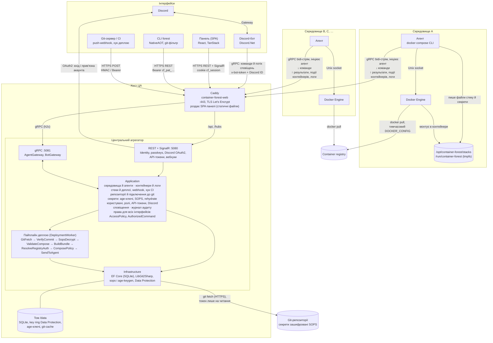

# Архітектура container-forest

Технічний опис системи: компоненти, протоколи, модель безпеки й прав. Для чого проєкт і чим він відрізняється від аналогів — у [README](../README.md) і [project-overview.md](project-overview.md). Архітектурні рішення з обґрунтуванням — в [adr/](adr/README.md).

## Компоненти системи

1. **Центральний агрегатор (ЦА)** — програма на ASP.NET, HTTP-сервер, gRPC-сервер; контролює все.
2. **Енвайронмент агент (ЕА)** — програма на .NET, встановлюється на кожне середовище, під'єднується як gRPC-клієнт до ЦА, спілкується з двигуном Docker через Unix socket, медіатор між ЦА і Docker.
3. **Панель** — SPA на React, веб-застосунок для ручного керування системою; браузер спілкується з ЦА через HTTP(S).
4. **Discord-бот** (не критично) — застосунок на .NET (фреймворк Discord.Net) для легковісного інтерфейсу керування в Discord; спілкується з ЦА через gRPC. Автентифікується власним сервісним токеном і передає Discord ID користувача, від імені якого діє; ЦА перевіряє права саме цього користувача.
5. **CLI `forest`** — .NET-застосунок (NativeAOT, один бінарник) для терміналу й скриптів; говорить із ЦА тим самим REST API, що й панель, з персональним API-токеном (ADR-0007, ADR-0008).
6. **База даних** — SQLite (PostgreSQL можливо в майбутньому; підтримка обох одразу означає два набори міграцій).

## Мови і фреймворки

1. Backend і все, не пов'язане з інтерфейсом — C#, .NET 10 (перейдемо на 11 після його релізу в листопаді, якщо залежності дозволять), агрегатор на ASP.NET Core (+ ASP.NET Core gRPC Service). ЦА має працювати у двох режимах: за reverse proxy, який термінує TLS (тоді `UseForwardedHeaders`), і без проксі, коли Kestrel сам обслуговує HTTPS із сертифікатом, заданим конфігурацією (файл сертифіката; випуск і поновлення — поза ЦА). Другий режим — не на часі.
2. Frontend: сайт окремою програмою на рівні з агентами, SPA, React, TS, TanStack Router, TanStack Query, React Context.

## Особливості модулів і системи

1. Опціонально можна реалізувати mTLS, щоб ускладнити неавторизоване підключення.
2. Аутентифікація за логіном і паролем за замовчуванням, вхід без пароля з passkey (WebAuthn, ADR-0009), 2FA, а також можливість налаштувати зовнішній вхід: OIDC (наприклад, Google) і OAuth2 (наприклад, Discord — він не підтримує OIDC).
3. ЦА розпоряджається приватними й публічними ключами для SOPS.
4. Система пайплайну деплою (абстрактна). Наприклад: ЦА: git fetch → sops decrypt → verify images → resolve target environments → resolve registry auth → build bundle → send to agent; ЕА: update stacks & secrets → docker pull → docker compose up; ЦА: пост-деплой хуки, логування тощо.
5. Керування стеками у веб-застосунку: up / down / restart / redeploy / redeploy with pull, логи контейнерів (приблизно як у Portainer), статус контейнерів, керування кожним контейнером окремо (start / stop / restart / remove?), exec?, attach console?, графіки використання ресурсів.
   - `restart` — `docker compose restart`, перезапуск процесів у наявних контейнерах;
   - `redeploy` — `docker compose up -d --pull missing`;
   - `redeploy with pull` — `docker compose up -d --pull always`;
   - `down` — окрема дія: видаляє контейнери й мережі стеку.
6. ЦА, якщо запущений на сервері, який має бути в системі, має мати агента для самого себе (див. «Самокерування»).
7. Керування доступом і користувачами: можна робити середовища приватними, видавати доступ окремим користувачам; можна видавати доступ і до окремих стеків (права наслідуються). Користувачам можна давати доступ лише до кнопок start / restart / stop або повний. Є користувачі-адміністратори, які мають доступ до всього і можуть керувати користувачами (див. «Права доступу»).

## Словник

- **Середовище (Environment)** — один хост з Docker і встановленим агентом.
- **Стек (Stack)** — набір сервісів, описаний одним `compose.yaml`; належить одному середовищу.
- **Агент (ЕА)** — сервіс на хості, який виконує команди ЦА через Docker. Сам нічого не вирішує.
- **Пакет (Bundle)** — усе, що ЦА надсилає агенту для деплою стеку: файли, розшифровані секрети, env, креди registry.
- **Деплой (Deployment)** — одне виконання пайплайну для конкретного стеку й коміту; має статус, лог і commit SHA.

## Схема і протоколи



| Від → до | Протокол | Автентифікація |
|---|---|---|
| Панель → ЦА | HTTPS REST + SignalR (WebSocket) | cookie сесії користувача (`cf_session`) |
| Бот → ЦА | gRPC | сервісний токен бота + Discord ID користувача, від імені якого діє |
| CLI, скрипти → ЦА | HTTPS REST | персональний API-токен у `Authorization: Bearer cf_pat_…` (ADR-0007) |
| Агент → ЦА | gRPC bidi-стрім (пакет `agent`), з'єднання відкриває агент | `agent_id` + секрет у metadata `x-agent-id` / `x-agent-secret` (опційно mTLS) |
| Агент → Docker | Unix socket | — (агент фактично має root на хості) |
| Docker → registry | HTTPS | тимчасовий `DOCKER_CONFIG` з кредами від ЦА |
| ЦА → Git | HTTPS | токен підключення лише на читання, лише під його префіксом (SSH не підтримується LibGit2Sharp) |
| ЦА → Discord | HTTPS (OAuth2, вхід і прив'язка акаунта, ADR-0009) | client id і client secret застосунку Discord |

## Інваріанти безпеки

Це правила, які не можна порушувати в жодному PR:

1. Приватні age-ключі існують **лише на ЦА**. Агенти їх ніколи не отримують.
2. Агент **не відкриває вхідних портів**. Усі з'єднання ініціює агент.
3. `environmentId` агента визначається з його автентифікації, **ніколи з вмісту повідомлення**.
4. Права перевіряються **лише на ЦА**. Панель і бот тільки ховають недоступні кнопки.
5. Агент виконує лише **фіксований набір типізованих команд**. Жодного «виконай довільну shell-команду».
6. Розшифровані секрети **не логуються**. Логи й аудит маскують значення.
7. Команди до офлайн-агента **не ставляться в чергу**: вони одразу завершуються помилкою.
8. Облікові дані агентів, паролі й API-токени користувачів зберігаються лише як хеші.
9. Токен Discord-бота захищається як адмінський: злам бота дозволяє діяти від імені будь-якого прив'язаного користувача.

## Права доступу

| Роль | Бачить стеки й статус | Логи | start / stop / restart | exec / консоль | Редагування стеку, деплой |
|---|---|---|---|---|---|
| Viewer | ✓ | ✓ | – | – | – |
| Operator | ✓ | ✓ | ✓ | – | – |
| Editor | ✓ | ✓ | ✓ | ✓ | ✓ |
| Адміністратор середовища | усе, що Editor, і адміністрування свого середовища (ADR-0012) | | | | |
| Admin | усе в системі, включно з керуванням користувачами | | | | |

- **Адміністратор середовища** (`EnvironmentAdmin`, ADR-0012) видається лише на все середовище й лише адміністратором: він фіксує, що людина й так має root на цьому хості. Він керує політикою compose середовища, ролями Viewer–Editor наявних користувачів на ньому та його стеках, age-ключами середовища й стеків, кредами registry, токеном реєстрації й відкликанням агента, назвою й приватністю. Користувачів, середовища, підключення до git, сповіщення, журнал аудиту й саму роль адміністратора середовища лишає за собою адміністратор.

- Роль видається на середовище або на окремий стек. **Ефективна роль на стеку = максимум із ролі на середовищі та ролі на стеку.** Явних заборон немає, щоб модель лишалась простою.
- Приватне середовище бачать лише ті, хто має роль на ньому або на одному з його стеків (у другому випадку — лише ці стеки).
- Середовище видаляє адміністратор, лише коли в ньому немає стеків; разом із ним зникають його age-ключі (файли, зашифровані лише для них, більше не розшифруються), креди registry, ролі й правила сповіщень, а агент від'єднується. Репозиторій видаляє той, хто може його змінювати, лише коли з нього не деплоїться жоден стек.
- Стеки додає й видаляє Editor середовища (Editor окремого стеку — ні). Видалити можна лише стек без контейнерів: ніколи не розгорнутий або зупинений через down; разом із ним зникають історія деплоїв, ролі на ньому й правила сповіщень про нього, а файли на хості лишаються.
- ⚠️ **Без політики compose Editor на середовищі фактично має root на хості**: compose-файл може змонтувати `/` хоста або запустити `privileged`-контейнер. Видавайте цю роль свідомо, а для середовищ, де це неприйнятно, вмикайте політику в режимі «Застосовувати» (див. «Політика compose»): тоді Editor обмежений своїми стеками.
- ⚠️ **Editor окремого стеку — теж, поки політика не застосовується**: його compose-файл може змонтувати каталоги й секрети інших стеків середовища. Секрети, зашифровані ключем середовища, він розшифровує через git-фільтр (ADR-0010) для всього середовища; секрети, яким потрібна ізоляція, шифруються ключем стеку (ADR-0012).
- ⚠️ **Право push у гілку стеку дорівнює праву деплою, а з ним — root на хості й відкритим секретам середовища**: деплой бере голову гілки, хоч би хто її змінив, навіть людина без облікового запису в системі чи зламаний git-сервер. Для стеку, де це неприйнятно, Editor вмикає «Деплоїти лише підписані коміти» (див. «Засвідчення вмісту»).
- ⚠️ Логи контейнерів можуть містити секрети, які застосунки самі вивели в stdout. Viewer їх побачить.
- Репозиторії й підключення до git-серверів (ADR-0006): підключення (префікс адреси, токен, дозволені середовища) створює лише адміністратор. Editor середовища або стеку додає публічні репозиторії й репозиторії під підключеннями, дозволеними в його середовищах; змінює репозиторій той, хто може деплоїти кожен його стек. Стек може брати лише репозиторій, дозволений у своєму середовищі, тож приватний репозиторій одного середовища не потрапить на хост іншого.
- **Passkeys** (ADR-0009): вхід без пароля ключем на пристрої. Додає й видаляє свої ключі лише сам користувач із сесії в панелі (не API-токеном); адміністратор може видалити ключ будь-кого, наприклад загубленого пристрою.
- **API-токени** (ADR-0007) діють від імені свого користувача з його ролями, але можуть мати менше: лише читання, лише перелічені середовища (інші для токена не існують, і прав адміністратора такий токен не має; адміністратор у цих середовищах — Editor), строк дії. Розшифровувати секрети SOPS (git-фільтр CLI, ADR-0010) може лише токен, створений із таким правом; токен лише для читання — ніколи. Токенами, паролем і прив'язкою Discord керує лише сесія в панелі, не токен: обмежений токен не може видати собі ширший. Адміністратор бачить і відкликає токени будь-кого.
- **Журнал аудиту** бачать лише адміністратори: входи (і невдалі, з ім'ям, яке ввели), зміни користувачів і ролей, токени, середовища, стеки, деплої, дії з контейнерами й розшифрування секретів, разом із відмовленими й невдалими спробами, хто й звідки (панель, API-токен, бот; IP-адреса). Паролів, токенів і вмісту файлів у ньому немає.
- Вхід через OAuth2/OIDC **не створює користувача автоматично з правами**: зовнішній акаунт або прив'язується до існуючого користувача, або створює користувача без жодних ролей. Вхід через Discord (ADR-0009) працює лише для Discord-акаунта, прив'язаного до користувача (кодом або через Discord); реєстрації через Discord немає.
- ⚠️ Прив'язаний Discord-акаунт — спосіб увійти в панель: його злам дає ті самі права, що й злам пароля.

## Самокерування

Якщо ЦА працює на хості, який сам є середовищем системи:

- Стеки ЦА і агента позначаються як **системні**. `down` і `remove` для них заборонені.
- ЦА, панель і агентів розгортають вручну за `deploy/*.yaml`, а не пайплайном, тож керованими стеками вони не є. Тому їхні compose-файли ставлять контейнерам мітку `com.container-forest.system: "true"`; агент передає її ЦА (`ContainerInfo.system`), і такі контейнери, як і контейнери системних стеків, можна лише запускати: stop і restart обірвали б з'єднання, яким ідуть команди (зупинений агент або Caddy відрізав би хост від ЦА). Ставлячи ці сервіси інакше, мітку треба додати самостійно.
- `restart` / `redeploy` системного стеку не можна виконувати напряму: агент, який робить `compose up` власного контейнера, зупиняє сам себе посеред команди. Оновлення виконується через одноразовий helper-контейнер, який агент запускає і який переживає перезапуск агента.
- Панель має очікувати, що після оновлення ЦА з'єднання обірветься, і показувати стан «перепідключення», а не помилку.

## Політика compose

Права ЦА вирішують, хто деплоїть, підписи — чий вміст, а політика compose середовища (ADR-0012) — що цей вміст може на хості. Режим задає адміністратор системи або середовища: «Вимкнено» (типово), «Аудит» (порушення — попередження в лозі деплою) або «Застосовувати» (деплой із порушенням падає до запуску compose).

1. Перевіряється не текст файлу, а модель, яку виконає compose: агент рендерить пакет `docker compose config` у тимчасовому каталозі на tmpfs з тими самими файлами, змінними й `--env-file`, що й під час деплою, а рішення приймає ЦА. Compose з політикою читає змінні лише з `.env` пакета.
2. Без винятків стеку не дозволено: `privileged`, namespace-и хоста, небезпечні capabilities і `security_opt`, пристрої, `docker.sock`, порти хоста нижче 1024, томи й мережі поза стеком, драйвери томів з опціями, контейнери поза стеком (`container:…`, `volumes_from`), мітки `com.container-forest.*` і `com.docker.compose.*`, `container_name`, що належить іншому стеку (ім'я належить стеку з найдовшою назвою, якій воно дорівнює або з якої починається з `-`), невідомі ключі. `env_file`, `extends`, `include` можуть посилатися лише на файли пакета.
3. Bind-mount'и: каталог стеку (для запису — з попередженням), каталог даних стеку `<каталог даних>/<стек>` (типово `/var/lib/container-forest/data/<стек>`), системні шляхи лише для читання (`/etc/localtime`, сертифікати тощо). Решта — за винятком середовища чи стеку (`path:` або `path-rw:`). Захищені шляхи (`/`, `/etc`, `/home`, `/run`, `/var/lib/docker`, `/opt/container-forest`, каталог даних інших стеків, їхні предки й нащадки) відкриває лише виняток стеку з точним шляхом.
4. Символьні посилання: джерело не може лежати всередині іншого джерела, змонтованого для запису, а агент перед `up` перевіряє, що в шляху немає посилань там, куди може писати контейнер (каталоги стеку й даних, джерела для запису, шляхи з `path-rw:`). Посилання, які міг створити лише root хоста (`/var/run` → `/run`), не заважають. Для шляхів поза своїми каталогами агенту потрібен корінь хоста лише для читання (`/:/host:ro,rslave`, `CF_AGENT__HOSTROOT`).
5. Кожне порушення називає виняток, який його знімає (`privileged`, `capability:SYS_ADMIN`, `port:443`, `path-rw:/srv/media`…). Винятки середовища діють для всіх його стеків, винятки стеку — лише для нього; задають їх адміністратори системи або середовища, кожна зміна — в аудиті.
6. Стек, якому root потрібен за призначенням, адміністратор системи чи середовища може вивести з-під політики перемикачем «Без обмежень політики»: його деплої однаково рендеряться й показуються у звіті, але нічого не перевіряється. Винятки й цей перемикач у панелі задаються формою з видами винятків, а у звіті біля порушення є «Дозволити для стеку» й «Для всього середовища».
7. Вміст, засвідчений адміністратором системи чи цього середовища (підпис або підтвердження SHA, ADR-0011), політика не зупиняє: порушення лише пишуться в лог. Натискання «Деплой» засвідченням не є.
8. Звіт на сторінці середовища перевіряє останню розгорнуту версію кожного стеку за поточними правилами: посилення політики не зупиняє контейнерів, що вже працюють. Rehydrate не перевіряється.

Політика не захищає від втечі через вразливість ядра й від вичерпання ресурсів хоста. Перехід: «Аудит» на всіх середовищах → звіт → винятки → «Застосовувати», починаючи з найменш довіреного хоста.

## Підключення до git-серверів

Приватні репозиторії ЦА тягне через **підключення** (ADR-0006): префікс адреси (`https://gitea.example.com/team/` — організація, весь сервер або один репозиторій), токен лише на читання й середовища, які можуть з них деплоїти. Токен надсилається лише на адреси під префіксом. Для Gitea, де токен не обмежується одним репозиторієм, підключенню дають токен службового користувача, доданого в команди з доступом на читання: що він бачить, вирішує Gitea, а підключення — яким середовищам це дозволено. Репозиторії під підключенням додають редактори без токенів. Репозиторій без підключення публічний; ЦА не тягне його з приватних адрес мережі (захист від SSRF), хіба що задано `Git:AllowPrivateHosts`.

## Деплой стеку

Деплой ставиться в чергу й виконується пайплайном кроків у ЦА; агент отримує готовий пакет і лише запускає `docker compose`. Секрети розшифровуються в ЦА ключами цільового середовища, а на хості лежать лише в tmpfs, тому після перезавантаження хоста ЦА сама повторно розгортає той самий коміт (rehydrate).

```mermaid
sequenceDiagram
  participant T as Панель / CLI / бот /<br/>webhook / хук CI
  participant CA as ЦА
  participant G as Git-сервер
  participant A as Агент
  participant D as Docker Engine
  participant R as Registry

  T->>CA: деплой стеку
  alt агент офлайн або стек уже деплоїться
    CA-->>T: 503 / 409, нічого не ставиться в чергу<br/>(webhook і хук CI — деплой після поточного)
  else
    CA-->>T: 202 Accepted, деплой у черзі
  end
  Note over CA: DeploymentWorker, кроки IDeployStep
  CA->>G: GitFetch: fetch гілки стеку<br/>токен підключення лише на читання
  G-->>CA: коміт (записується в деплой до читання файлів)
  opt стек вимагає підписаних комітів (ADR-0011)
    CA->>CA: VerifyCommit: SSH-підпис ключем людини з правом деплою<br/>або коміт, підтверджений за SHA; інакше деплой падає до розшифрування
  end
  CA->>CA: SopsDecrypt: файли з метаданими sops<br/>розшифровуються ключами лише цільового середовища
  CA->>CA: ValidateCompose (без build:, попередження про latest)<br/>BuildBundle (до 3 MiB), ResolveRegistryAuth
  opt у середовища є політика compose (ADR-0012)
    CA->>A: RenderStack: ті самі файли
    A-->>CA: модель docker compose config, посилання в шляхах
    CA->>CA: ComposePolicy: правила й винятки; у «Застосовувати» порушення зупиняє деплой
  end
  CA->>A: DeployStack: файли, секретні файли,<br/>креди registry лише для образів стеку
  A->>A: файли стеку на місці (ADR-0004), копія в .prev<br/>секрети → /run/container-forest (tmpfs),<br/>у каталозі стеку — посилання на них
  A->>D: docker compose up -d --remove-orphans --wait<br/>--pull missing | always, тимчасовий DOCKER_CONFIG
  D->>R: docker pull
  A-->>CA: CommandProgress: вивід compose → лог деплою
  opt «Перезапускати після зміни файлів» і файли змінилися
    A->>D: docker compose restart
  end
  A-->>CA: CommandResult
  Note over A: видалити DOCKER_CONFIG і .prev секретів
  CA-->>T: статус і лог (SignalR, історія деплоїв),<br/>сповіщення в Discord

  Note over T,R: Перезавантаження хоста: tmpfs порожній, контейнери з файловими секретами не стартують
  A->>CA: Hello з новим boot_id
  CA->>CA: rehydrate: деплой того самого коміту<br/>для кожного стеку, розгорнутого із секретами
  CA->>A: DeployStack (той самий коміт, pull missing)
  A->>D: docker compose up -d
```

## Засвідчення вмісту (підписи комітів)

Права ЦА вирішують, хто запускає деплой, але вміст — це голова гілки на git-сервері. Стек із «Деплоїти лише підписані коміти» (ADR-0011) приймає лише вміст, який засвідчила людина з правом деплою цього стеку:

1. Кожен додає свій публічний SSH-ключ в «Обліковий запис» → «Ключі підпису комітів» і підписує коміти (`git config gpg.format ssh`, `user.signingkey`, `commit.gpgsign true`). Ключ можна обмежити середовищами: так роблять із ключем на менш довіреній машині. Обмеження лише звужує права власника, як в API-токена. Службовому користувачу без входу (CI) ключ додає адміністратор, і це видно поруч із кожним підписом. Покрокове налаштування для Linux, macOS і Windows, GitHub і Gitea — у [«Підпис комітів і git по SSH»](signing-commits.md).
2. Після fetch ЦА бере SSH-підпис голови гілки, знаходить ключ за відбитком, перевіряє підпис `ssh-keygen -Y verify` і права власника на момент деплою. Лише потім розшифровуються секрети. Підпис голови засвідчує весь стан репозиторію, включно з непідписаними комітами під нею.
3. Деплой після push і хук CI додатково не відкочують стек: новий коміт має бути нащадком розгорнутого, інакше (force-push, зміна джерела) — лише вручну.
4. Непідписаний коміт (наприклад, merge у веб-інтерфейсі git-сервера, підписаний ключем платформи) деплоїться, лише коли людина з правом деплою підтвердить саме його SHA на екрані деплою або `forest stack deploy --approve <sha>`. Якщо гілка тим часом пішла далі, деплой падає.
5. Rehydrate того самого коміту не перевіряється: він уже працює.

Історія деплоїв показує, хто засвідчив вміст: ім'я, відбиток ключа або «підтверджено вручну». Підпис покриває тег образу, а не образ у registry, тому для повної гарантії — «Лише образи з digest» (`image: app@sha256:…`).

## Деплой після push (webhook)

1. Хтось, хто може змінювати репозиторій, створює його секрет webhook у панелі («Репозиторії» → «Змінити» → «Webhook»). Секрет і адресу `https://<домен>/api/webhooks/<id репозиторію>` панель показує один раз; їх вставляють у налаштування webhook на GitHub (content type `application/json`, подія push), Gitea/Forgejo або GitLab (Secret token). Замість webhook на кожен репозиторій адміністратор може створити один webhook організації на підключенні (`https://<домен>/api/webhooks/connections/<id підключення>`): ЦА знайде репозиторій за адресою з тіла запиту.
2. Editor стеку вмикає «Деплой після push» на екрані стеку. Без цього push стек не чіпає.
3. Push у гілку стеку ставить у чергу звичайний деплой із тригером «Webhook»: ЦА перевіряє підпис секретом репозиторію й тягне голову гілки сам, тіло запиту лише каже, що вона змінилася. Push під час деплою стеку розгортається одразу після нього.

ЦА відповідає 401 однаково на неправильний підпис і на невідомий репозиторій чи підключення. Тіло й підпис не логуються. До офлайн-агента деплой не ставиться (інваріант 7).

## Хук деплою для CI

Деплой після push бере лише відсутні образи, тож новий образ під тим самим тегом (`latest`, `main`) він не підтягне. Для таких образів у стеку є хук деплою: Editor стеку створює його на екрані стеку («Хук деплою для CI»), панель один раз показує адресу `https://<домен>/api/deploy-hooks/<id стеку>` і токен, а CI після push образу викликає:

```sh
curl -fsS -X POST -H "Authorization: Bearer $FOREST_DEPLOY_HOOK" https://<домен>/api/deploy-hooks/<id стеку>
```

ЦА деплоїть голову гілки стеку з оновленням усіх образів (redeploy with pull), тригер в історії — «Хук деплою». Виклик під час деплою стеку розгортається одразу після нього. ЦА зберігає лише хеш токена; токен передається в заголовку, а не в адресі, бо адреси зберігають логи проксі й CI. На неправильний токен і невідомий стек — однаковий 401, до офлайн-агента — 503 (інваріант 7).

Відтворюваніший шлях — образи з незмінним тегом (`:<sha коміту>`), який CI комітить у репозиторій стеку: тоді вистачає деплою після push, а відкат — це `git revert`.

## Вхід у CLI

CLI `forest` автентифікується API-токеном (ADR-0007) і вміє отримати його через браузер (ADR-0008):

1. `forest login` просить ЦА розпочати вхід і відкриває панель на сторінці підтвердження; з `--device` (по SSH) друкує адресу й код, який вводять у панелі на будь-якому пристрої.
2. Людина входить у панель будь-яким способом, звіряє код із терміналом, обирає обмеження токена й дозволяє вхід. Рішення приймає лише сесія в панелі, не токен.
3. CLI опитує ЦА своїм секретним кодом і отримує токен: ЦА створює його лише в цю мить і віддає один раз. Браузер токена не бачить; після рішення він лише будить CLI через `127.0.0.1`.

Запити живуть 10 хвилин, коди зберігаються хешами, ендпоінти без автентифікації мають ліміт запитів на адресу. Підтверджуйте лише вхід, який щойно запустили самі: сторінка показує хост і адресу запиту саме для цього.

`forest login --secrets` просить токен, що може розшифровувати секрети для git-фільтра (ADR-0010); галочку на сторінці підтвердження людина лишає або знімає сама.

Бінарники CLI для Linux, macOS і Windows публікуються в GitHub Releases за тегом `cli-v<версія>`. Токен CLI зберігає в контексті (`$XDG_CONFIG_HOME/container-forest/config.json`, лише для власника) або бере з `--token`, `--token-file`, `CF_TOKEN`. `forest logout` відкликає його на сервері. Права ті самі, що в панелі, з обмеженнями токена; токенами, паролем і прив'язкою Discord CLI не керує.

## Секрети в git (SOPS)

Секрети стеку лежать у репозиторії поруч із compose-файлом, зашифровані [SOPS](https://github.com/getsops/sops) для age-ключа середовища. Ключі створює адміністратор у панелі («Ключі SOPS»): приватна частина генерується й лишається в ЦА (зашифрована Data Protection, ADR-0003); публічну (`age1…`) бачить кожен, хто бачить середовище.

Під час деплою ЦА розшифровує файли з метаданими sops ключами **лише цільового середовища** й передає агенту як секретні: агент пише їх у tmpfs (`/run/container-forest`), а в каталог стеку кладе символьні посилання, тож compose-файл посилається на них звичайними відносними шляхами (`env_file: .env`, `secrets: … file: ./secrets/db_password`). На диск хоста й у логи відкритий текст не потрапляє.

Редагувати секрети можна двома способами; у git в обох випадках лежать ті самі стандартні файли sops.

### Через `forest` (рекомендовано, ADR-0010)

Git-фільтр CLI: у клоні секрети — відкритий текст, у git — зашифровані. Особисті age-ключі не потрібні.

1. Один раз на репозиторій: `forest secrets init --rule stacks/prod/=prod --rule stacks/staging/=staging` (або `-e <середовище>`, якщо середовище одне). Команда записує `.sops.yaml` з публічними ключами середовищ і `.gitattributes` з файлами, які фільтр шифрує (типово `.env` і `**/secrets/**`). Обидва файли треба закомітити. Для репозиторію, де sops-файли вже є, — `forest secrets adopt`. Секрети мають лежати в каталозі compose-файлу стеку або нижче: у пакет деплою ЦА бере лише його.
2. Кожна людина в своєму клоні: `forest login --secrets <сервер>` (у браузері лишити галочку «Розшифрування секретів»), потім `forest git setup`. Файли середовищ, де вона Editor, стають відкритим текстом; решта лишаються зашифрованими, і клон працює далі.
3. Далі звичайний git: змінити `.env`, `git commit`. Фільтр шифрує файл через ЦА за правилом `.sops.yaml`, а незмінений файл зберігає свій шифротекст. Pre-commit хук і `forest secrets check` у CI не пропускають відкритий текст. ЦА відмовляється деплоїти файл під `filter=forest`, що потрапив у git незашифрованим.

ЦА розшифровує файл лише ключами середовищ, де людина — Editor (середовища або його стеку); адміністратор — усі. Ключ окремого стеку (ADR-0012, `forest env key create --stack <стек>`, правило `forest secrets rule add <шлях>=<середовище>/<стек>`) розшифровує лише деплой цього стеку й ті, хто може його деплоїти: скопійований у чужий каталог шифротекст ЦА не розшифрує. Ключ середовища — для секретів, спільних для його стеків. Ізоляцію ключем стеку дає лише політика compose в режимі «Застосовувати»: без неї Editor стеку прочитає tmpfs іншого стеку через compose. Токен CLI має мати право розшифровувати секрети; ЦА логує, хто який файл розшифрував.

### Вручну через `sops`

1. У `.sops.yaml` додається правило з публічним ключем середовища й власним ключем того, хто редагує секрети (інакше файл зможе розшифрувати лише ЦА).
2. Файл шифрується `sops encrypt --in-place` і комітиться.

Обидва способи можна змішувати: клон без `forest git setup` бачить зашифровані файли й працює з ними `sops`, а фільтр пропускає вже зашифрований файл як є. З `forest git setup --local-sops` фільтр спершу розшифровує власними ключами людини й шифрує локальним `sops`, тож працює й без ЦА.

### Ротація й відновлення

- **Нове середовище в репозиторії**: `forest secrets rule add stacks/staging/=staging` → закомітити `.sops.yaml` → `forest secrets updatekeys`. `forest secrets rule list` показує правила з назвами середовищ.
- **Ротація ключа**: новий ключ → публічний ключ у `.sops.yaml` → `forest secrets updatekeys` (або `sops updatekeys`) → видалити старий ключ. Доки старий ключ є, обидва розшифровують.
- **Файл більше не під фільтром**: `forest secrets remove <файл>` лишає його в git зашифрованим для ручного `sops`; `--plain --yes` комітить відкритий текст, але зашифровані версії лишаються в історії.
- **Windows і закінчення рядків**: git перетворює закінчення рядків до фільтра, і з `core.autocrlf` (типово в Git for Windows) шифротекст доходить до sops із CRLF, якого той не читає. Тому `forest` пише правила `.gitattributes` з `eol=lf`, а відкритий dotenv та INI, збережений редактором із CRLF, шифрує без CR. Для репозиторію з правилами без `eol=lf` (`forest git setup`, `secrets status` і `secrets check` про це кажуть) — `forest secrets fix-eol` і закомітити результат.
- **Клон іде до іншої людини чи машини**: `forest git teardown` вимикає фільтр і повертає секретам шифротекст; токен CLI відкликає `forest logout`.
- **Зміна людей**: зняття ролі не стирає відкритий текст із клонів, тож після цього секрети середовища треба змінити.
- **Відновлення**: без власного чи резервного ключа файли розшифровує лише ЦА. `forest secrets init --recovery age1…` додає резервний ключ до кожного правила; бекап тому ЦА обов'язковий у будь-якому разі.

⚠️ Env-секрети (`env_file`, `environment`) Docker однаково зберігає в конфігурації контейнера на диску (`docker inspect`). Справді не торкаються диска лише файлові секрети.

## Поведінка при збоях

- **Агент офлайн** → середовище позначається `Offline`, кнопки дій неактивні, команди одразу повертають помилку. Якщо агент не повернувся за 2 хвилини (`CF_NOTIFICATIONS__AGENTOFFLINEDELAY`), правила сповіщень отримують подію «Агент офлайн», а після повернення — «Агент знову онлайн».
- **Контейнер упав або став unhealthy** → правила сповіщень отримують подію «Контейнер упав» (з кодом виходу, якщо він відомий) чи «Контейнер unhealthy». Зупинка, перезапуск і перестворення через Docker, панель чи деплой падінням не вважаються, як і вихід із кодом 0; контейнер у циклі перезапусків дає одне повідомлення за 10 хвилин. Коли контейнер, про який надіслано «unhealthy», знову проходить перевірку здоров'я, приходить «Контейнер знову здоровий».
- **Перезавантаження хоста** → файлові секрети в `/run/container-forest` (tmpfs) зникають. Агент після підключення повідомляє новий `boot_id`, ЦА повторно деплоїть той самий коміт кожного стеку, розгорнутого із секретами (rehydrate, тригер «Відновлення секретів» в історії деплоїв): секрети знову з'являються в tmpfs, а `compose up -d` запускає контейнери, що не стартували без них. Гілка при цьому не підтягується: деплоїться те, що вже працювало.
- **Змінився конфіг, а не образ** → `compose up` не перестворює контейнер, якщо не змінилося його визначення в compose-файлі, а застосунки читають змонтовані файли лише на старті. Для таких стеків на екрані стеку вмикається «Перезапускати після зміни файлів»: тоді агент після деплою, що змінив будь-який файл стеку, крім `compose.yaml`, перезапускає стек.
- **Деплой впав** → попередні файли стеку зберігаються в `/opt/container-forest/stacks/<stack>.prev`, доступний rollback. Каталог стеку при цьому не замінюється: оновлюються лише файли пакета, дані контейнерів у ньому лишаються (ADR-0004).
- **ЦА недоступний** → контейнери на хостах продовжують працювати. Агент перепідключається з експоненційною затримкою.

## Не входить у скоуп

- Docker Swarm, Kubernetes.
- Збірка образів на хостах (`build:` у compose). Образи збирає CI і публікує в registry.
- Власний container registry.
- Встановлення й оновлення самого Docker Engine.

## Розгортання ЦА

ЦА і панель працюють на одному хості: [`deploy/aggregator/compose.yaml`](../deploy/aggregator/compose.yaml). Єдиний вхід — Caddy в образі панелі (ADR-0005): він віддає SPA, проксює `/api`, `/hubs` і gRPC агентів і бота на ЦА й сам отримує сертифікат Let's Encrypt для домену. ЦА портів назовні не публікує.

```
Інтернет :443 → container-forest-web (Caddy)
                  ├─ /             → файли панелі
                  ├─ /api, /hubs   → aggregator:5080
                  └─ gRPC          → aggregator:5081 (h2c) ← агенти й бот
```

- Налаштування — у `.env` поруч із compose-файлом (не комітиться, доступний лише root): `CF_DOMAIN` (DNS-запис має вказувати на хост, порти 80 і 443 відкриті), перший адміністратор `CF_BOOTSTRAP__*`, за потреби хеш токена бота.
- Вхід і прив'язка через Discord (ADR-0009, необов'язково): `CF_DISCORDAUTH__CLIENTID` і `CF_DISCORDAUTH__CLIENTSECRET` застосунку Discord (Developer Portal → OAuth2; можна той самий, що й у бота), а в ньому — redirect `https://<CF_DOMAIN>/api/auth/discord/callback`. Client secret — секрет рівня токена бота.
- Дані ЦА — том `aggregator-data` (`/data`: база, key ring Data Protection, git-клони). Бекапити цілком: без key ring не розшифруються ні збережені креди й токени, ні приватні age-ключі середовищ, а без них — і секрети в репозиторіях, зашифровані лише для цих ключів.
- Образ ЦА містить `sops` і `age-keygen` (версії й контрольні суми — у `scripts/install-sops.sh`) і `ssh-keygen` (`openssh-client`) для перевірки підписів комітів.
- Сертифікати Caddy — том `caddy-data`.
- Агенти й бот підключаються до `https://<CF_DOMAIN>`.
- Образи — `ghcr.io/lepterion/container-forest-*` (workflow `Images` публікує їх з `main`). Поки репозиторій приватний, приватні й образи: на хості потрібен `docker login ghcr.io` з токеном GitHub із правом `read:packages`.

## Розгортання агента

Приклад — [`deploy/agent/compose.yaml`](../deploy/agent/compose.yaml). Каталоги монтуються за **однаковим шляхом** на хості й у контейнері: `docker compose` усередині агента працює через socket хоста, і шляхи bind-mount'ів резолвить daemon на хості.

```yaml
services:
  container-forest-agent:
    image: ghcr.io/lepterion/container-forest-agent:latest
    restart: unless-stopped
    hostname: <назва хоста>   # агент передає її ЦА при реєстрації; без неї в панелі буде id контейнера
    environment:
      CF_AGENT__CONTROLLERURL: https://forest.example.com
      CF_AGENT__ENROLLMENTTOKEN: ${ENROLLMENT_TOKEN}   # потрібен лише для першого запуску
      CF_AGENT__HOSTROOT: /host
    volumes:
      - /var/run/docker.sock:/var/run/docker.sock
      - /opt/container-forest:/opt/container-forest
      - /run/container-forest:/run/container-forest
      - /:/host:ro,rslave   # для політики compose (ADR-0012): перевірка символьних посилань у шляхах bind-mount'ів
```

## Розгортання Discord-бота

Бот — окремий контейнер без стану: лише вихідні з'єднання з Discord і з gRPC-портом ЦА, без томів і вхідних портів. Приклад — [`deploy/discord-bot/compose.yaml`](../deploy/discord-bot/compose.yaml): образ `container-forest-discord-bot` працює від непривілейованого користувача, з файловою системою лише для читання, без capabilities.

- `CF_BOT__CONTROLLERURL` — gRPC-адреса ЦА (та сама, що для агентів).
- `CF_BOT__SERVICETOKEN` — сервісний токен бота; ЦА зберігає лише його SHA-256 у `CF_BOTGATEWAY__TOKENHASHES__0`.
- `CF_DISCORD__TOKEN` — токен бота Discord. Невірний токен зупиняє контейнер з кодом 1 і підказкою в лозі.

⚠️ Обидва токени рівносильні адмінському доступу (інваріант 9). У прикладі вони приходять із `.env` поруч із compose-файлом, який не комітиться і доступний лише root.
