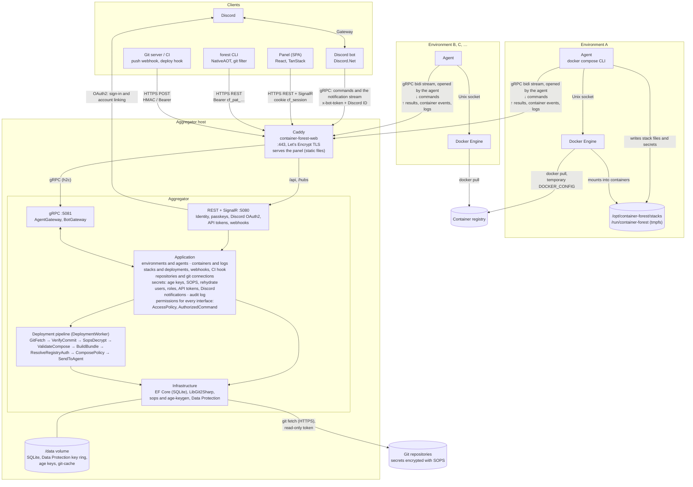
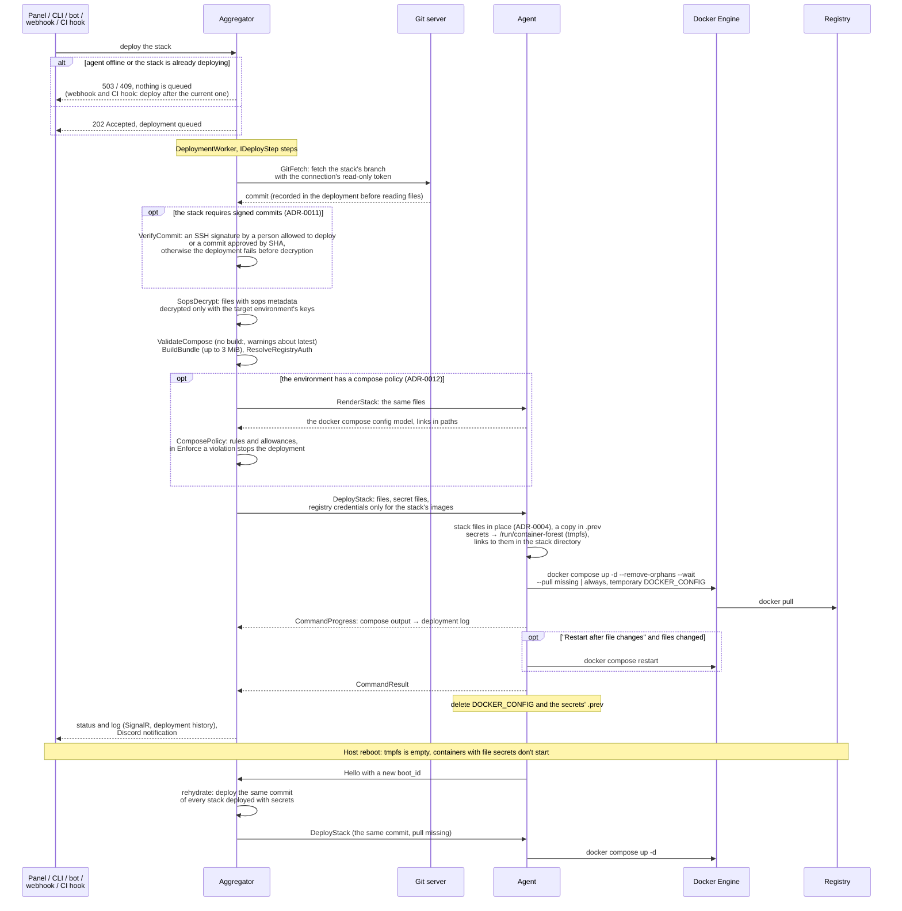

# container-forest architecture

A technical description of the system: components, protocols, the security and permission model. What the project is for and how it differs from similar tools: the [README](../README.md) and [comparison.md](comparison.md). Architectural decisions with their reasoning: [adr/](adr/README.md). Installing it: [installation.md](installation.md).

## Components

1. **The aggregator**: an ASP.NET Core application, an HTTP and gRPC server; it controls everything.
2. **The agent**: a .NET application installed on every environment. It connects to the aggregator as a gRPC client, talks to the Docker engine through a Unix socket, and mediates between the aggregator and Docker.
3. **The panel**: a React SPA for managing the system by hand; the browser talks to the aggregator over HTTP(S).
4. **The Discord bot** (optional): a .NET application (Discord.Net) giving a lightweight interface in Discord; it talks to the aggregator over gRPC. It authenticates with its own service token and passes the Discord ID of the user it acts for; the aggregator checks that user's permissions.
5. **The `forest` CLI**: a .NET application (NativeAOT, a single binary) for terminals and scripts; it uses the same REST API as the panel, with a personal API token (ADR-0007, ADR-0008).
6. **The database**: SQLite (PostgreSQL possibly in the future; supporting both at once means two sets of migrations).

## Languages and frameworks

1. The backend and everything not tied to the interface: C#, .NET 10, the aggregator on ASP.NET Core (+ ASP.NET Core gRPC). The aggregator works behind a reverse proxy that terminates TLS (with `ASPNETCORE_FORWARDEDHEADERS_ENABLED`). Running without a proxy, with Kestrel serving HTTPS itself from a configured certificate, isn't supported yet.
2. The frontend: a separate application alongside the agents, an SPA in React and TypeScript with TanStack Router, TanStack Query and React Context.

## Features of the system

1. mTLS between agents and the aggregator, to make unauthorised connections harder, is a possible future addition.
2. Sign-in with a user name and password, passwordless sign-in with passkeys (WebAuthn, ADR-0009) and Discord OAuth2. 2FA and external sign-in through OIDC (e.g. Google) are planned.
3. The aggregator holds the private and public keys for SOPS.
4. A deployment pipeline of steps. Roughly: aggregator: git fetch → sops decrypt → verify images → resolve registry auth → build bundle → send to agent; agent: update stack files and secrets → docker pull → docker compose up; aggregator: logging, notifications.
5. Managing stacks in the panel: up / down / restart / redeploy / redeploy with pull, container logs, container state, and managing each container separately (start / stop / restart / remove). Resource usage graphs for containers, stacks and servers. exec and an attached console are planned.
   - `restart`: `docker compose restart`, restarting the processes in the existing containers;
   - `redeploy`: `docker compose up -d --pull missing`;
   - `redeploy with pull`: `docker compose up -d --pull always`;
   - `down`: a separate action that removes the stack's containers and networks.
6. If the aggregator runs on a server that should be part of the system, that server gets an agent too (see "Self-management").
7. Access and user management: environments can be private, access can be given to individual users, and also to individual stacks (permissions are inherited). Users can be limited to the start / restart / stop buttons or given full access. Administrators have access to everything and manage users (see "Permissions").

## Glossary

- **Environment**: one host with Docker and an agent installed.
- **Stack**: a set of services described by one `compose.yaml`; it belongs to one environment.
- **Agent**: the service on a host that carries out the aggregator's commands through Docker. It decides nothing itself.
- **Bundle**: everything the aggregator sends an agent to deploy a stack: files, decrypted secrets, env, registry credentials.
- **Deployment**: one run of the pipeline for a particular stack and commit; it has a status, a log and a commit SHA.

## Diagram and protocols



| From → to | Protocol | Authentication |
|---|---|---|
| Panel → aggregator | HTTPS REST + SignalR (WebSocket) | the user's session cookie (`cf_session`) |
| Bot → aggregator | gRPC | the bot's service token + the Discord ID of the user it acts for |
| CLI, scripts → aggregator | HTTPS REST | a personal API token in `Authorization: Bearer cf_pat_…` (ADR-0007) |
| Agent → aggregator | gRPC bidi stream (package `agent`), opened by the agent | `agent_id` + a secret in the `x-agent-id` / `x-agent-secret` metadata |
| Agent → Docker | Unix socket | none (the agent is effectively root on the host) |
| Docker → registry | HTTPS | a temporary `DOCKER_CONFIG` with credentials from the aggregator |
| Aggregator → git | HTTPS | the connection's read-only token, only under its prefix (LibGit2Sharp doesn't support SSH) |
| Aggregator → Discord | HTTPS (OAuth2 sign-in and account linking, ADR-0009) | the Discord application's client id and client secret |

## Security invariants

The rules no PR may break: [security-invariants.md](security-invariants.md).

## Permissions

| Role | Sees stacks and state | Logs | start / stop / restart | exec / console | Edit stacks, deploy |
|---|---|---|---|---|---|
| Viewer | ✓ | ✓ | – | – | – |
| Operator | ✓ | ✓ | ✓ | – | – |
| Editor | ✓ | ✓ | ✓ | ✓ | ✓ |
| Environment administrator | everything an Editor can, plus administering their environment (ADR-0012) | | | | |
| Admin | everything in the system, including user management | | | | |

- **The environment administrator** (`EnvironmentAdmin`, ADR-0012) is granted only on a whole environment and only by an administrator: it records that the person is root on that host anyway. They manage the environment's compose policy, the Viewer–Editor roles of existing users on it and its stacks, the age keys of the environment and its stacks, registry credentials, the enrollment token and revoking the agent, the name and privacy. Users, environments, git connections, notifications, the audit log and the environment administrator role itself stay with the administrator.

- A role is granted on an environment or on a single stack. **The effective role on a stack is the higher of the environment role and the stack role.** There are no explicit denies, to keep the model simple.
- A private environment is visible only to those with a role on it or on one of its stacks (in the latter case, only those stacks).
- An administrator deletes an environment, only when it has no stacks; its age keys (files encrypted only to them can't be decrypted any more), registry credentials, roles and notification rules go with it, and the agent is disconnected. Whoever may change a repository deletes it, only when no stack deploys from it.
- An environment's Editor adds and deletes stacks (an Editor of a single stack can't). Only a stack without containers can be deleted: never deployed, or taken down; its deployment history, the roles on it and notification rules about it go with it, and its files stay on the host.
- ⚠️ **Without a compose policy, an Editor on an environment is effectively root on the host**: a compose file can mount the host's `/` or run a `privileged` container. Grant this role deliberately, and for environments where that isn't acceptable, set the policy to *Enforce* (see "Compose policy"): the Editor is then limited to their stacks.
- ⚠️ **So is an Editor of a single stack, as long as the policy isn't enforced**: their compose file can mount the directories and secrets of the environment's other stacks. They decrypt secrets encrypted with the environment's key through the git filter (ADR-0010) for the whole environment; secrets that need isolation are encrypted with a stack key (ADR-0012).
- ⚠️ **Push access to a stack's branch equals the right to deploy, and with it root on the host and the environment's secrets in plain text**: a deployment takes the branch head whoever changed it, even someone without an account in the system, or a compromised git server. For a stack where that isn't acceptable, an Editor turns on *Deploy only signed commits* (see "Content endorsement").
- ⚠️ Container logs can contain secrets that applications print to stdout themselves. A Viewer will see them.
- Repositories and git connections (ADR-0006): only an administrator creates a connection (a URL prefix, a token, the allowed environments). An Editor of an environment or a stack adds public repositories and repositories under connections allowed in their environments; whoever can deploy every stack of a repository can change it. A stack can only use a repository allowed in its environment, so one environment's private repository never reaches another's host.
- **Passkeys** (ADR-0009): passwordless sign-in with a key on a device. Only the user adds and removes their own keys, from a panel session (not with an API token); an administrator can remove anyone's key, for example for a lost device.
- **API tokens** (ADR-0007) act for their user with the user's roles, but can have less: read-only, only the listed environments (others don't exist for the token, and such a token has no administrator rights; an administrator is an Editor in those environments), an expiry. Only a token created with that right can decrypt SOPS secrets (the CLI's git filter, ADR-0010); a read-only token never can. Only a panel session manages tokens, the password and Discord linking, never a token: a restricted token can't issue itself a broader one. An administrator sees and revokes anyone's tokens.
- **The audit log** is visible only to administrators: sign-ins (failed ones too, with the name entered), changes to users and roles, tokens, environments, stacks, deployments, container actions and secret decryption, including denied and failed attempts, who did it and from where (panel, API token, bot; IP address). It holds no passwords, tokens or file contents.
- Signing in through OAuth2/OIDC **never creates a user with permissions automatically**: the external account is either linked to an existing user or creates a user without any roles. Signing in with Discord (ADR-0009) works only for a Discord account linked to a user (by code or through Discord); there's no sign-up through Discord.
- ⚠️ A linked Discord account is a way into the panel: compromising it gives the same rights as compromising the password.

## Self-management

If the aggregator runs on a host that is itself an environment of the system:

- The aggregator's and the agent's stacks are marked as **system** stacks. `down` and `remove` are forbidden for them.
- The aggregator, the panel and the agents are deployed by hand from `deploy/*.yaml`, not by the pipeline, so they aren't managed stacks. Their compose files therefore give the containers the label `com.container-forest.system: "true"`; the agent passes it to the aggregator (`ContainerInfo.system`), and such containers, like those of system stacks, can only be started: stop and restart would cut the connection commands travel on (a stopped agent or Caddy would cut the host off from the aggregator). If you install these services differently, add the label yourself.
- A system stack can't be restarted or redeployed directly: an agent running `compose up` on its own container stops itself mid-command. Updates go through a one-off helper container that the agent starts and that survives the agent's restart.
- The panel expects the connection to drop after the aggregator is upgraded and shows a *reconnecting* state rather than an error.

## Compose policy

The aggregator's permissions decide who deploys, signatures decide whose content it is, and the environment's compose policy (ADR-0012) decides what that content may do on the host. A system or environment administrator sets the mode: *Off* (the default), *Audit* (violations are warnings in the deployment log) or *Enforce* (a deployment with a violation fails before compose runs).

1. What's checked isn't the file's text but the model compose will run: the agent renders the bundle with `docker compose config` in a temporary directory on tmpfs, with the same files, variables and `--env-file` as the deployment, and the aggregator decides. Under a policy, compose reads variables only from the bundle's `.env`.
2. Without a stack allowance, these aren't allowed: `privileged`, host namespaces, dangerous capabilities and `security_opt`, devices, `docker.sock`, host ports below 1024, volumes and networks outside the stack, volume drivers with options, containers outside the stack (`container:…`, `volumes_from`), the labels `com.container-forest.*` and `com.docker.compose.*`, a `container_name` belonging to another stack (a name belongs to the stack with the longest name that it equals or starts with followed by `-`), unknown keys. `env_file`, `extends` and `include` may only refer to files in the bundle.
3. Bind mounts: the stack directory (with a warning for writing), the stack's data directory `<data directory>/<stack>` (`/var/lib/container-forest/data/<stack>` by default), system paths read-only (`/etc/localtime`, certificates, etc.). Anything else needs an environment or stack allowance (`path:` or `path-rw:`). Protected paths (`/`, `/etc`, `/home`, `/run`, `/var/lib/docker`, `/opt/container-forest`, other stacks' data directories, their ancestors and descendants) are opened only by a stack allowance with the exact path.
4. Symbolic links: a source can't lie inside another source mounted for writing, and before `up` the agent checks that the path has no links where a container could write (the stack and data directories, sources mounted for writing, `path-rw:` paths). Links only the host's root could have created (`/var/run` → `/run`) don't count. For paths outside its own directories the agent needs the host root read-only (`/:/host:ro,rslave`, `CF_AGENT__HOSTROOT`).
5. Every violation names the allowance that lifts it (`privileged`, `capability:SYS_ADMIN`, `port:443`, `path-rw:/srv/media`…). Environment allowances apply to all its stacks, stack allowances only to that stack; system or environment administrators set them, and every change is audited.
6. A stack that needs root by design can be taken out from under the policy by a system or environment administrator with the *No policy restrictions* switch: its deployments are still rendered and shown in the report, but nothing is checked. In the panel, allowances and this switch are set in a form listing the kinds of allowances, and the report has *Allow for the stack* and *For the whole environment* next to a violation.
7. Content endorsed by a system administrator or this environment's administrator (a signature or a SHA approval, ADR-0011) isn't stopped by the policy: violations are only logged. Pressing *Deploy* isn't an endorsement.
8. The report on the environment's page checks the last deployed version of each stack against the current rules: tightening the policy doesn't stop containers that already run. Rehydrate isn't checked.

The policy doesn't protect against escaping through a kernel vulnerability or against exhausting the host's resources. A migration path: *Audit* on every environment → the report → allowances → *Enforce*, starting with the least trusted host.

## Git connections

The aggregator fetches private repositories through **connections** (ADR-0006): a URL prefix (`https://gitea.example.com/team/` for an organisation, a whole server or a single repository), a read-only token and the environments that may deploy from them. The token is sent only to URLs under the prefix. For Gitea, where a token can't be limited to one repository, give the connection the token of a service user added to teams with read access: Gitea decides what it sees, and the connection decides which environments may use it. Editors add repositories under a connection without tokens. A repository without a connection is public; the aggregator won't fetch it from private network addresses (SSRF protection) unless `Git:AllowPrivateHosts` is set.

## Deploying a stack

A deployment is queued and run by a pipeline of steps in the aggregator; the agent receives a ready bundle and only runs `docker compose`. Secrets are decrypted in the aggregator with the target environment's keys and exist on the host only in tmpfs, so after a host reboot the aggregator redeploys the same commit itself (rehydrate).



## Content endorsement (commit signatures)

The aggregator's permissions decide who starts a deployment, but the content is the branch head on the git server. A stack with *Deploy only signed commits* (ADR-0011) accepts only content endorsed by a person allowed to deploy that stack:

1. Everyone adds their public SSH key under *Account* → *Commit signing keys* and signs their commits (`git config gpg.format ssh`, `user.signingkey`, `commit.gpgsign true`). A key can be limited to some environments, as you'd do with a key on a less trusted machine. The limit only narrows its owner's rights, as with an API token. For a service user without sign-in (CI), an administrator adds the key, and that's shown next to every signature. Step-by-step setup for Linux, macOS and Windows, GitHub and Gitea: [Commit signing and git over SSH](signing-commits.md).
2. After the fetch, the aggregator takes the branch head's SSH signature, finds the key by fingerprint, verifies the signature with `ssh-keygen -Y verify` and checks the owner's permissions at deployment time. Only then are secrets decrypted. The head's signature endorses the whole state of the repository, including unsigned commits under it.
3. Deploy on push and the CI hook also never roll a stack back: the new commit must descend from the deployed one; otherwise (a force push, a changed source) only by hand.
4. An unsigned commit (for example a merge in the git server's web interface, signed with the platform's key) is deployed only once a person allowed to deploy approves its exact SHA on the deployment screen or with `forest stack deploy --approve <sha>`. If the branch has moved on meanwhile, the deployment fails.
5. Rehydrating the same commit isn't verified: it's already running.

The deployment history shows who endorsed the content: a name, a key fingerprint or *approved by hand*. A signature covers the image's tag, not the image in the registry, so for a full guarantee use *Only images with a digest* (`image: app@sha256:…`).

## Deploy on push (webhook)

1. Someone who may change the repository creates its webhook secret in the panel (*Repositories* → *Edit* → *Webhook*). The panel shows the secret and the URL `https://<domain>/api/webhooks/<repository id>` once; paste them into the webhook settings on GitHub (content type `application/json`, the push event), Gitea/Forgejo or GitLab (Secret token). Instead of a webhook per repository, an administrator can create one organisation webhook on the connection (`https://<domain>/api/webhooks/connections/<connection id>`): the aggregator finds the repository by the URL in the request body.
2. A stack's Editor turns on *Deploy on push* on the stack's screen. Without it, pushes don't touch the stack.
3. A push to the stack's branch queues an ordinary deployment with the *Webhook* trigger: the aggregator checks the signature with the repository's secret and fetches the branch head itself; the body only says it changed. A push during a deployment of the stack is deployed right after it.

The aggregator answers 401 the same way to a wrong signature and to an unknown repository or connection. Neither the body nor the signature is logged. Nothing is queued for an offline agent (invariant 7).

## Deploy hook for CI

Deploy on push pulls only missing images, so it won't pick up a new image under the same tag (`latest`, `main`). For such images a stack has a deploy hook: a stack's Editor creates it on the stack's screen (*Deploy hook for CI*), the panel shows the URL `https://<domain>/api/deploy-hooks/<stack id>` and the token once, and after pushing an image CI calls:

```sh
curl -fsS -X POST -H "Authorization: Bearer $FOREST_DEPLOY_HOOK" https://<domain>/api/deploy-hooks/<stack id>
```

The aggregator deploys the stack's branch head, pulling every image (redeploy with pull); the trigger in the history is *Deploy hook*. A call during a deployment of the stack is deployed right after it. The aggregator stores only the token's hash; the token goes in a header rather than the URL, since proxy and CI logs keep URLs. A wrong token and an unknown stack get the same 401, an offline agent a 503 (invariant 7).

A more reproducible path is images with an immutable tag (`main-<commit sha>`) that the aggregator itself commits to the stack's repository (ADR-0015). A stack's Editor adds an image policy on the stack's screen: the image, a pattern of allowed tags (`^main-[0-9a-f]{7}\z`) and how to tell which is newer. An administrator sets a write token on the connection. From then on the aggregator polls the registry (every 5 minutes by default), or CI calls the stack's image hook right after a build:

```sh
curl -fsS -X POST -H "Authorization: Bearer $FOREST_IMAGE_HOOK" -H 'Content-Type: application/json' \
  -d '{"image":"registry.example.com/team/app"}' https://<domain>/api/image-hooks/<stack id>
```

The aggregator commits the new tag into the stack's compose file, signs the commit with its own key, pushes, and deploys exactly that commit (trigger *Image update*). CI needs neither write access to the deployment repository nor a signing key; rolling back is a `git revert`, or pinning an older tag on the stack's screen.

## CLI sign-in

The `forest` CLI authenticates with an API token (ADR-0007) and can get one through the browser (ADR-0008):

1. `forest login` asks the aggregator to start a sign-in and opens the panel on the confirmation page; with `--device` (over SSH) it prints a URL and a code to enter in the panel on any device.
2. The person signs in to the panel any way they like, compares the code with the terminal, picks the token's restrictions and allows the sign-in. Only a panel session decides, never a token.
3. The CLI polls the aggregator with its secret code and receives the token: the aggregator creates it only at that moment and hands it out once. The browser never sees the token; after the decision it only wakes the CLI through `127.0.0.1`.

Requests live 10 minutes, codes are stored as hashes, and unauthenticated endpoints are rate-limited per address. Only approve a sign-in you have just started yourself: the page shows the request's host and address for exactly that.

`forest login --secrets` asks for a token that can decrypt secrets for the git filter (ADR-0010); the person keeps or clears the checkbox on the confirmation page.

CLI binaries for Linux, macOS and Windows are attached to the GitHub Release of every system version (`vX.Y.Z`; before 0.8.0, the tag `cli-v<version>`). The CLI keeps the token in a context (`$XDG_CONFIG_HOME/container-forest/config.json`, owner-only) or takes it from `--token`, `--token-file` or `CF_TOKEN`. `forest logout` revokes it on the server. The permissions are the same as in the panel, with the token's restrictions; the CLI doesn't manage tokens, the password or Discord linking.

## Secrets in git (SOPS)

A stack's secrets live in the repository next to the compose file, encrypted with [SOPS](https://github.com/getsops/sops) to the environment's age key. An administrator creates keys in the panel (*SOPS keys*): the private part is generated and stays in the aggregator (encrypted with Data Protection, ADR-0003); everyone who sees the environment sees the public part (`age1…`).

During a deployment the aggregator decrypts files with sops metadata with **only the target environment's** keys and passes them to the agent as secret: the agent writes them to tmpfs (`/run/container-forest`) and puts symbolic links into the stack directory, so the compose file refers to them by ordinary relative paths (`env_file: .env`, `secrets: … file: ./secrets/db_password`). Plain text never reaches the host's disk or the logs.

There are two ways to edit secrets; in both cases git holds the same standard sops files.

### With `forest` (recommended, ADR-0010)

The CLI's git filter: secrets are plain text in your clone and encrypted in git. No personal age keys are needed.

1. Once per repository: `forest secrets init --rule stacks/prod/=prod --rule stacks/staging/=staging` (or `-e <environment>` if there's one environment). It writes `.sops.yaml` with the environments' public keys and `.gitattributes` with the files the filter encrypts (`.env` and `**/secrets/**` by default). Commit both. For a repository that already has sops files, use `forest secrets adopt`. Secrets must be in the stack's compose file directory or below: that's all the aggregator puts into the bundle.
2. Each person in their clone: `forest login --secrets <server>` (keep *Decrypt secrets* checked in the browser), then `forest git setup`. Files of environments where they're an Editor become plain text; the rest stay encrypted, and the clone keeps working.
3. Then ordinary git: change `.env`, `git commit`. The filter encrypts the file through the aggregator by the `.sops.yaml` rule, and an unchanged file keeps its ciphertext. The pre-commit hook and `forest secrets check` in CI don't let plain text through. The aggregator refuses to deploy a file under `filter=forest` that reached git unencrypted.

The aggregator decrypts a file only with the keys of environments where the person is an Editor (of the environment or one of its stacks); an administrator gets all of them. A single stack's key (ADR-0012, `forest env key create --stack <stack>`, the rule `forest secrets rule add <path>=<environment>/<stack>`) is decrypted only by that stack's deployments and by those who can deploy it: ciphertext copied to another directory won't be decrypted. The environment's key is for secrets shared by its stacks. Only a compose policy in *Enforce* makes a stack key an isolation boundary: without it, a stack's Editor can read another stack's tmpfs through compose. The CLI's token must be allowed to decrypt secrets; the aggregator logs who decrypted which file.

### By hand with `sops`

1. Add a rule to `.sops.yaml` with the environment's public key and the editor's own key (otherwise only the aggregator can decrypt the file).
2. Encrypt the file with `sops encrypt --in-place` and commit it.

The two ways can be mixed: a clone without `forest git setup` sees encrypted files and works with them through `sops`, and the filter passes an already encrypted file through as is. With `forest git setup --local-sops` the filter first tries the person's own keys and encrypts with a local `sops`, so it works without the aggregator too.

### Rotation and recovery

- **A new environment in the repository:** `forest secrets rule add stacks/staging/=staging` → commit `.sops.yaml` → `forest secrets updatekeys`. `forest secrets rule list` shows the rules with environment names.
- **Rotating a key:** a new key → its public key in `.sops.yaml` → `forest secrets updatekeys` (or `sops updatekeys`) → delete the old key. While the old key exists, both decrypt.
- **A file no longer under the filter:** `forest secrets remove <file>` leaves it encrypted in git for manual `sops`; `--plain --yes` commits the plain text, but the encrypted versions stay in history.
- **Windows and line endings:** git converts line endings before the filter, and with `core.autocrlf` (the default in Git for Windows) ciphertext reaches sops with CRLF, which it can't read. So `forest` writes `.gitattributes` rules with `eol=lf` and encrypts plain dotenv and INI files saved by an editor with CRLF without the CR. For a repository with rules lacking `eol=lf` (`forest git setup`, `secrets status` and `secrets check` say so), run `forest secrets fix-eol` and commit the result.
- **A clone goes to another person or machine:** `forest git teardown` turns off the filter and gives the secrets their ciphertext back; `forest logout` revokes the CLI's token.
- **People change:** removing a role doesn't erase plain text from their clones, so change the environment's secrets afterwards.
- **Recovery:** without your own or a backup key, only the aggregator can decrypt the files. `forest secrets init --recovery age1…` adds a backup key to every rule; back up the aggregator in any case.

⚠️ Docker still stores env secrets (`env_file`, `environment`) in the container's configuration on disk (`docker inspect`). Only file secrets truly never touch the disk.

## Failure behaviour

- **An agent goes offline** → the environment is marked `Offline`, action buttons are disabled, and commands fail at once. If the agent hasn't come back within 2 minutes (`CF_NOTIFICATIONS__AGENTOFFLINEDELAY`), notification rules get an *Agent offline* event, and *Agent back online* once it returns.
- **A container crashes or becomes unhealthy** → notification rules get *Container crashed* (with the exit code if known) or *Container unhealthy*. Stopping, restarting and recreating through Docker, the panel or a deployment don't count as crashes, nor does an exit with code 0; a container in a restart loop produces one message per 10 minutes. When a container reported as unhealthy passes its health check again, *Container healthy again* arrives.
- **A host reboots** → file secrets in `/run/container-forest` (tmpfs) disappear. After connecting, the agent reports a new `boot_id`, and the aggregator redeploys the same commit of every stack deployed with secrets (rehydrate, trigger *Secret restore* in the deployment history): the secrets reappear in tmpfs, and `compose up -d` starts the containers that couldn't start without them. The branch isn't pulled: what was already running is deployed.
- **The config changed, not the image** → `compose up` doesn't recreate a container whose definition in the compose file didn't change, and applications read mounted files only at start. For such stacks, turn on *Restart after file changes* on the stack's screen: then, after a deployment that changed any of the stack's files except `compose.yaml`, the agent restarts the stack.
- **A deployment fails** → the previous stack files are kept in `/opt/container-forest/stacks/<stack>.prev`. To go back, roll the stack back to a commit it deployed before (ADR-0018): the deployment history, `forest stack rollback`. The stack directory isn't replaced: only the bundle's files are updated, and container data in it stays (ADR-0004).
- **The aggregator's data is lost** → restore from a backup ([procedure](design/backup.md#restoring)). System-wide rules get a *Backup failed* event for a failed backup, and after a failure it's retried every hour.
- **The aggregator is unreachable** → containers on the hosts keep running. Agents reconnect with exponential backoff.

## Out of scope

- Docker Swarm, Kubernetes.
- Building images on hosts (`build:` in compose). CI builds images and publishes them to a registry.
- A container registry of our own.
- Installing and upgrading Docker Engine itself.

## Deployment

How to deploy the aggregator with the panel, the agents and the bot, and what each setting means: [installation.md](installation.md). The compose files are in `deploy/`.
